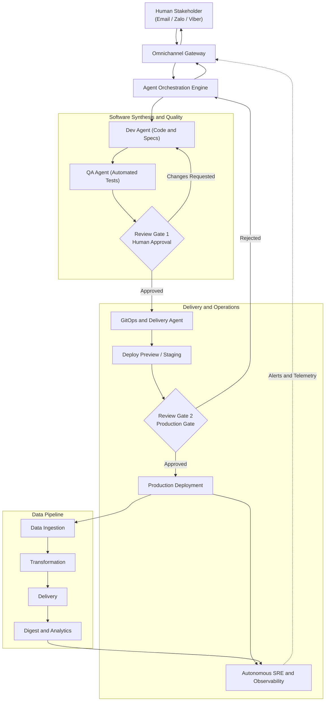

# Stratum

> **An Autonomous, AI-Agent-Driven Software Engineering and Operations Ecosystem**  
> *100% AI Generated Code, Tests, Artifacts, and Infrastructure — Governed by Human-in-the-Loop Review.*

---

## 🌟 Vision & Overview

**Stratum** is a unified, fully autonomous software lifecycle system where AI agents execute the entire software engineering lifecycle—from change request intake to code synthesis, test automation, infrastructure provisioning, production deployment, data pipelining, and runtime operations.

Human stakeholders maintain strategic governance and oversight through lightweight approval checkpoints delivered directly via conversational channels (**Email**, **Zalo**, and **Viber**).

---

## 🏛️ Core Principles

1. **100% AI-Generated Code & Automated Testing**
   - No manual source code authoring. AI agents produce all implementation code, schemas, and API contracts.
   - 100% test automation generated alongside code: unit, integration, regression, and end-to-end (E2E) suites.

2. **Omnichannel Conversational Interface**
   - Natural, conversational interaction across primary communication channels:
     - **Email:** `sonnormal@gmail.com`
     - **Chat Platforms:** Zalo & Viber
   - Issues, change requests, status updates, and interactive approvals are conducted via email threads and instant messaging.

3. **Human-in-the-Loop (HITL) Governance**
   - AI agents propose plans, generate code, run validations, and stage deployments.
   - Explicit human review checkpoints gate critical actions (architecture decisions, production deployments, sensitive data access, infrastructure teardowns).

4. **100% AI-Generated Artifacts**
   - Documentation, architecture diagrams, API specifications (OpenAPI/AsyncAPI), user manuals, and release notes are automatically generated, synced, and kept up to date.

5. **100% Infrastructure as Code (IaC) & Autonomous CI/CD**
   - Declarative infrastructure definitions managed through code (e.g., OpenTofu/Terraform, Kubernetes manifests, Helm, or CloudFormation).
   - Automated continuous integration and deployment pipelines trigger based on agent PRs and human approval signals.

6. **AI-Observed & Self-Healing Operations (AIOps)**
   - Continuous observability: Metrics, logs, traces, and synthetics are monitored in real time by autonomous SRE agents.
   - Anomaly detection, root cause analysis (RCA), and remediation plans are generated autonomously and dispatched for human review when necessary.

7. **Unified End-to-End Ecosystem**
   - All capabilities exist in a single coordinated ecosystem of microservices and applications:
     - **Management & Planning:** Change requests, issue prioritization, backlog management.
     - **Implementation:** Code synthesis, refactoring, test execution.
     - **Data Lifecycle:** Data ingestion $\rightarrow$ Transformation $\rightarrow$ Delivery $\rightarrow$ Digestion/Analytics.
     - **Operations:** Provisioning, CI/CD, telemetry monitoring, incident response.

---

## 🔄 End-to-End Workflow


<details open>
<summary><b>📐 View Mermaid Source</b></summary>



</details>

---

## 🏗️ Multi-Repository Strategy

To ensure security isolation, independent release lifecycles, and scoped AI agent contexts, **Stratum is organized as a multi-repository ecosystem** rather than a single monolithic repository.

### Why Infrastructure as Code (IaC) Must Be Separated

1. **Security & Least-Privilege Blast Radius:**
   - IaC requires elevated cloud-provider privileges (IAM, VPC, DNS, state backends).
   - Application dev-agents must **never** have write access to cloud infrastructure or state files, preventing accidental destruction or unauthorized privilege escalation.
2. **Independent Lifecycle & Velocity:**
   - Infrastructure changes (cloud networks, clusters, databases) happen on a different schedule with stricter change controls than application code.
3. **AI Agent Context Scoping:**
   - AI agents operate with maximum accuracy when provided clean, tightly focused repository boundaries rather than overwhelming context.
4. **Auditability & Compliance:**
   - Changes to infrastructure have an immutable audit trail isolated from routine code refactoring and bug fixes.

---

## 📦 Stratum Repository Catalog

```text
┌────────────────────────────────────────────────────────────────────────┐
│                        stratum (Hub / Meta)                            │
│           Global Architecture, Governance, Schemas & Docs              │
└───────────────────┬────────────────────────────────┬───────────────────┘
                    │                                │
    ┌───────────────┴───────────────┐  ┌─────────────┴─────────────┐
    │  Infrastructure & Operations  │  │    Platform & Services    │
    ├───────────────────────────────┤  ├───────────────────────────┤
    │ • stratum-infra (IaC)         │  │ • stratum-gateway         │
    │ • stratum-gitops              │  │ • stratum-orchestrator    │
    │ • stratum-aiops               │  │ • stratum-data-platform   │
    │                               │  │ • stratum-services/*      │
    └───────────────────────────────┘  └───────────────────────────┘
```

### 1. Ecosystem Meta & Governance
* **[`stratum`](https://github.com/your-org/stratum)** *(Current Repo)*
  - **Role:** Central ecosystem documentation, global architecture decision records (ADRs), cross-repo orchestration guidelines, and AI agent prompts/policies.

### 2. Infrastructure as Code (Strict Isolation)
* **`stratum-infra`**
  - **Role:** 100% Infrastructure as Code for foundational cloud environments.
  - **Tech:** Terraform / OpenTofu, Terragrunt, Cloud Networking, IAM, Kubernetes clusters, Managed DBs, KMS/Vault secrets.
  - **Governance:** Dedicated Infra Review Gate. AI Infra Agent proposes `terraform plan` outputs; human must approve prior to `apply`.
* **`stratum-gitops`**
  - **Role:** Declarative environment definitions separating application code from cluster state.
  - **Tech:** ArgoCD / Flux manifests, Helm charts, Kustomize overlays (staging, prod).

### 3. Core Platform Services
* **`stratum-gateway`**
  - **Role:** Omnichannel communication hub. Handles webhook ingests and outbound messaging for **Email (`sonnormal@gmail.com`)**, **Zalo**, and **Viber**. Converts messages into structured events.
* **`stratum-orchestrator`**
  - **Role:** The AI coordination brain. Manages task delegation, state machines, review checkpoint triggers, and callback routing.
* **`stratum-aiops`**
  - **Role:** Runtime observability and autonomous SRE. Ingests OpenTelemetry traces, metrics, and logs. Runs anomaly detection, synthetic transactions, and triggers automated remediation proposals.

### 4. Data Platform
* **`stratum-data-platform`**
  - **Role:** End-to-end data lifecycle services:
    - **Ingest:** Connectors for event streams, APIs, batch uploads.
    - **Transform:** Streaming and batch transformation pipelines (dbt, Spark/Flink).
    - **Delivery:** Query endpoints, data warehouse synchronization, cache warming.
    - **Digest:** Analytical aggregations, scheduled reports, and autonomous summary generation.

### 5. Application Microservices
* **`stratum-services`** (or domain-specific repos, e.g. `stratum-service-*`)
  - **Role:** Business logic microservices.
  - 100% AI-generated application code and unit/integration test suites.
  - Generates container images and publishes image tags consumed by `stratum-gitops`.

---

## 🧩 Architectural Building Blocks

| Component | Repository | Role | Description |
| :--- | :--- | :--- | :--- |
| **Omnichannel Gateway** | `stratum-gateway` | Interface | Inbound/outbound bridge for Email (`sonnormal@gmail.com`), Zalo, and Viber. Translates conversation into structured agent directives. |
| **Orchestrator** | `stratum-orchestrator` | Coordination | Schedules agent jobs, handles state machines, and enforces Human-in-the-Loop review gates. |
| **Software Factory** | `stratum-services/*` | Implementation | Specialized dev/test agents producing 100% of domain code, test suites, and OpenAPI specs. |
| **Data Platform** | `stratum-data-platform` | Data Flow | End-to-end data pipeline: Ingest $\rightarrow$ Transform $\rightarrow$ Deliver $\rightarrow$ Digest. |
| **Infra as Code (IaC)** | `stratum-infra` | Foundation | 100% declarative cloud infrastructure, cloud security, and compute clusters. |
| **Delivery Engine** | `stratum-gitops` | Deployment | GitOps declarative delivery tracking preview, staging, and production rollouts. |
| **Autonomous SRE** | `stratum-aiops` | Operations | Telemetry evaluation, automated synthetic tests, log anomaly detection, and incident remediation proposals. |

---

## 💬 Interaction Channels

- **Primary Email:** [`sonnormal@gmail.com`](mailto:sonnormal@gmail.com)
  - Architectural proposals, change request specs, milestone reviews, and formal audit logs.
- **Instant Chat (Zalo / Viber):**
  - Real-time notifications, interactive approval buttons (Approve / Reject / Revise), incident alerts, and conversational query interface.

---

## 🚀 Getting Started & Roadmap

### Phase 1: Foundation & Gateway
- [ ] Configure Omnichannel Gateway for Email, Zalo, and Viber.
- [ ] Setup Agent Orchestration runtime and Human-in-the-Loop checkpoint engine.
- [ ] Establish repository conventions and automated Git workflows.

### Phase 2: Autonomous Development & Delivery
- [ ] AI-driven code and test generation pipeline with branch protection and review gates.
- [ ] Automated IaC and CI/CD pipelines deploying to ephemeral test environments.
- [ ] Review-and-approve mechanisms via interactive chat/email callbacks.

### Phase 3: Autonomous Data & Operations
- [ ] Data lifecycle service (Ingest $\rightarrow$ Transform $\rightarrow$ Delivery $\rightarrow$ Digest).
- [ ] Autonomous SRE monitoring, telemetry analysis, and incident alerting back to user channels.
- [ ] Continuous self-optimization loop.
