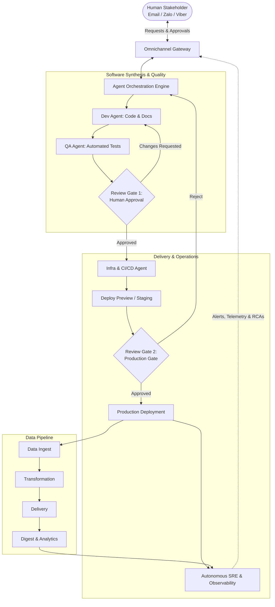

# Stratum

> **An Autonomous, AI-Agent-Driven Software Engineering and Operations Ecosystem**  
> *100% AI Generated Code, Tests, Artifacts, and Infrastructure — Governed by Human-in-the-Loop Review.*

---

## 🌟 Vision & Overview

**Stratum** is a unified, fully autonomous software lifecycle system where AI agents execute the entire software engineering lifecycle—from change request intake to code synthesis, test automation, infrastructure provisioning, production deployment, data pipelining, and runtime operations.

Human stakeholders maintain strategic governance and oversight through lightweight approval checkpoints delivered directly via conversational channels (**Email**, **Zalo**, and **Viber**).

---

## 🏛️ Core Principles

1. **100% AI-Generated Code & Automated Testing**
   - No manual source code authoring. AI agents produce all implementation code, schemas, and API contracts.
   - 100% test automation generated alongside code: unit, integration, regression, and end-to-end (E2E) suites.

2. **Omnichannel Conversational Interface**
   - Natural, conversational interaction across primary communication channels:
     - **Email:** `sonnormal@gmail.com`
     - **Chat Platforms:** Zalo & Viber
   - Issues, change requests, status updates, and interactive approvals are conducted via email threads and instant messaging.

3. **Human-in-the-Loop (HITL) Governance**
   - AI agents propose plans, generate code, run validations, and stage deployments.
   - Explicit human review checkpoints gate critical actions (architecture decisions, production deployments, sensitive data access, infrastructure teardowns).

4. **100% AI-Generated Artifacts**
   - Documentation, architecture diagrams, API specifications (OpenAPI/AsyncAPI), user manuals, and release notes are automatically generated, synced, and kept up to date.

5. **100% Infrastructure as Code (IaC) & Autonomous CI/CD**
   - Declarative infrastructure definitions managed through code (e.g., OpenTofu/Terraform, Kubernetes manifests, Helm, or CloudFormation).
   - Automated continuous integration and deployment pipelines trigger based on agent PRs and human approval signals.

6. **AI-Observed & Self-Healing Operations (AIOps)**
   - Continuous observability: Metrics, logs, traces, and synthetics are monitored in real time by autonomous SRE agents.
   - Anomaly detection, root cause analysis (RCA), and remediation plans are generated autonomously and dispatched for human review when necessary.

7. **Unified End-to-End Ecosystem**
   - All capabilities exist in a single coordinated ecosystem of microservices and applications:
     - **Management & Planning:** Change requests, issue prioritization, backlog management.
     - **Implementation:** Code synthesis, refactoring, test execution.
     - **Data Lifecycle:** Data ingestion $\rightarrow$ Transformation $\rightarrow$ Delivery $\rightarrow$ Digestion/Analytics.
     - **Operations:** Provisioning, CI/CD, telemetry monitoring, incident response.

---

## 🔄 End-to-End Workflow



---

## 🧩 Architectural Building Blocks

| Component | Role | Description |
| :--- | :--- | :--- |
| **Omnichannel Gateway** | Interface | Connects inbound/outbound messages via Email (`sonnormal@gmail.com`), Zalo Bot API, and Viber Bot API. Translates chat/email into structured agent tasks. |
| **Orchestration & Governance Engine** | Brain | Coordinates multi-agent workflows, task decomposition, dependency resolution, and maintains stateful human approval checkpoints. |
| **Software Factory (Dev & QA)** | Implementation | Agent teams dedicated to generating application logic, unit/integration tests, documentation, and pull requests. |
| **Platform & Delivery (IaC & CI/CD)** | Infrastructure | Declarative IaC management, containerization, pipeline execution, environment provisioning, and automated canary/blue-green rollouts. |
| **Data Platform** | Data Flow | Orchestrates automated data pipelines: Ingest $\rightarrow$ Transform $\rightarrow$ Deliver $\rightarrow$ Digest. |
| **Observability & SRE Agent** | Operations | Telemetry evaluation, automated synthetic tests, log anomaly detection, and automated remediation proposals. |

---

## 💬 Interaction Channels

- **Primary Email:** [`sonnormal@gmail.com`](mailto:sonnormal@gmail.com)
  - Daily digests, architectural proposals, high-level milestone signoffs, and audit trails.
- **Messaging (Zalo / Viber):**
  - Instant change requests, interactive approval cards (Approve / Reject / Request Revision), rapid alert notifications, and quick status queries.

---

## 📁 Proposed Repository Layout

```text
stratum/
├── README.md                           # Ecosystem master documentation
├── .stratum/                           # System configs, agent policies, approval rules
│   ├── approvals.yaml                  # Governance checkpoints & reviewer configuration
│   └── channels.yaml                   # Email, Zalo, Viber integrations
├── apps/                               # Core platform services
│   ├── gateway/                        # Omnichannel bridge (Email, Zalo, Viber)
│   ├── orchestrator/                   # Agent workflow engine & state machine
│   ├── data-pipeline/                  # Ingestion, transformation, delivery & digest
│   └── ops-monitor/                    # AIOps telemetry collector & health checker
├── services/                           # AI-generated domain business microservices
├── infra/                              # 100% Infrastructure as Code
│   ├── terraform/                      # Cloud infrastructure declarations
│   └── k8s/                            # Workload definitions & GitOps manifests
├── tests/                              # Global integration & E2E test suites
└── docs/                               # 100% AI-generated architectural & API docs
```

---

## 🚀 Getting Started & Roadmap

### Phase 1: Foundation & Gateway
- [ ] Configure Omnichannel Gateway for Email, Zalo, and Viber.
- [ ] Setup Agent Orchestration runtime and Human-in-the-Loop checkpoint engine.
- [ ] Establish repository conventions and automated Git workflows.

### Phase 2: Autonomous Development & Delivery
- [ ] AI-driven code and test generation pipeline with branch protection and review gates.
- [ ] Automated IaC and CI/CD pipelines deploying to ephemeral test environments.
- [ ] Review-and-approve mechanisms via interactive chat/email callbacks.

### Phase 3: Autonomous Data & Operations
- [ ] Data lifecycle service (Ingest $\rightarrow$ Transform $\rightarrow$ Delivery $\rightarrow$ Digest).
- [ ] Autonomous SRE monitoring, telemetry analysis, and incident alerting back to user channels.
- [ ] Continuous self-optimization loop.
