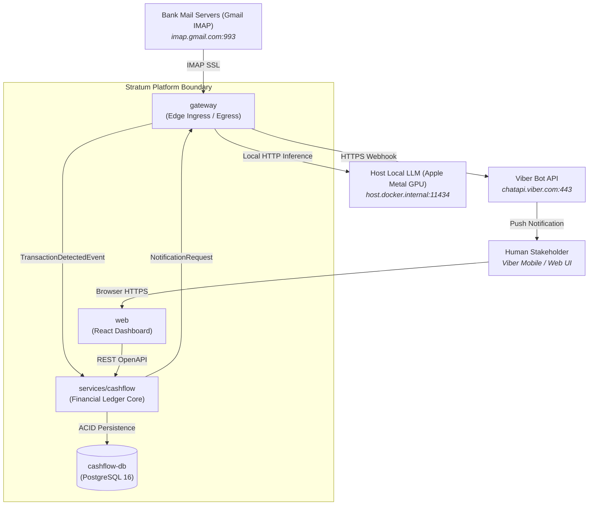

# 🌐 Stratum System Architecture Landscape

> **Document Type:** System Architecture Blueprint & Topology Specification  
> **Status:** `ACTIVE`  
> **Applies to:** Entire Stratum Ecosystem (`gateway`, `services/*`, `web`, `meta`)  
> **Governing Decisions:** [ADR-26j001](file:///Users/son/Projects/Stratum/stratum-meta/architecture/adrs/ADR-26j001-containerized-local-runtime.md), [ADR-26j002](file:///Users/son/Projects/Stratum/stratum-meta/architecture/adrs/ADR-26j002-strict-tdd-and-testcontainers.md), [ADR-26j003](file:///Users/son/Projects/Stratum/stratum-meta/architecture/adrs/ADR-26j003-local-llm-extraction-ollama.md), [ADR-26j004](file:///Users/son/Projects/Stratum/stratum-meta/architecture/adrs/ADR-26j004-ecosystem-technology-stack.md)

---

## 📌 1. Macro System Context (C4 Level 1)

Stratum is a decoupled, containerized multi-repository platform for autonomous financial ingestion and cashflow tracking.

---

## 🧱 2. Repository Boundaries & Responsibilities

To avoid context pollution for AI agents, each repository maintains strict boundaries. No repository may access another repository's database directly.

| Repository | Scope & Role | Owns | Does NOT Own | Authoritative Contracts |
| :--- | :--- | :--- | :--- | :--- |
| [**`gateway`**](file:///Users/son/Projects/Stratum/gateway) | Perimeter Ingress & Egress Edge | IMAP fetcher, MIME parsing, Ollama prompt client, Viber dispatcher | Ledger state, account balances, financial categorization | [TransactionDetectedEvent (v1)](file:///Users/son/Projects/Stratum/stratum-meta/contracts/events/transaction_detected.v1.json) |
| [**`services/cashflow`**](file:///Users/son/Projects/Stratum/services/cashflow) | Financial Core Domain | Account movements, balances, idempotency keys, category tracking, DB migrations | IMAP credentials, MIME parsing, Viber webhook tokens | PostgreSQL DDL, [contracts/](file:///Users/son/Projects/Stratum/stratum-meta/contracts) |
| [**`web`**](file:///Users/son/Projects/Stratum/web) | Stakeholder Dashboard | React SPA, Vite configuration, UI components | Business calculations, persistence | OpenAPI schemas exposed by `services/cashflow` |
| [**`stratum-meta`**](file:///Users/son/Projects/Stratum/stratum-meta) | Governance & Specifications | Architecture blueprints, ADRs, engineering standards, contracts, flows, CR archive | Implementation code, test runners | All ecosystem standards |

---

## 🌐 3. Network Zones & Service Ports

| Zone | Network Name | Members | Ingress Allowed | Egress Allowed |
| :--- | :--- | :--- | :--- | :--- |
| **Perimeter** | `stratum-perimeter-net` | `gateway` (port 8000) | Stakeholder Webhooks | External Internet (IMAP, Viber), Host Ollama (`:11434`) |
| **Internal** | `stratum-internal-net` | `services/cashflow` (port 8001), `web` (port 5173) | `gateway`, `web` | Internal services only (**Zero public internet**) |
| **Data** | `stratum-data-net` | `cashflow-db` (PostgreSQL, port 5432) | `services/cashflow` | None (**Zero external access**) |

---

## 🧭 4. Authoritative Specifications (Single Sources of Truth)

AI development agents must refer directly to the canonical documents below rather than assuming details:

* **Detailed Sequence Choreography:** See [**`flows/email-transaction-ingestion.md`**](file:///Users/son/Projects/Stratum/stratum-meta/flows/email-transaction-ingestion.md) (owns the step-by-step event pipeline).
* **Domain Acceptance Criteria:** See [**`features/vib-transaction-alert.md`**](file:///Users/son/Projects/Stratum/stratum-meta/features/vib-transaction-alert.md).
* **Data Schemas & JSON Contracts:** See [**`contracts/`**](file:///Users/son/Projects/Stratum/stratum-meta/contracts).
* **Technology & Stack Decisions:** See [**`architecture/adrs/`**](file:///Users/son/Projects/Stratum/stratum-meta/architecture/adrs/README.md).
* **Universal SDLC & Testing Rules:** See [**`standards/sdlc.md`**](file:///Users/son/Projects/Stratum/stratum-meta/standards/sdlc.md) and [**`standards/testing.md`**](file:///Users/son/Projects/Stratum/stratum-meta/standards/testing.md).
