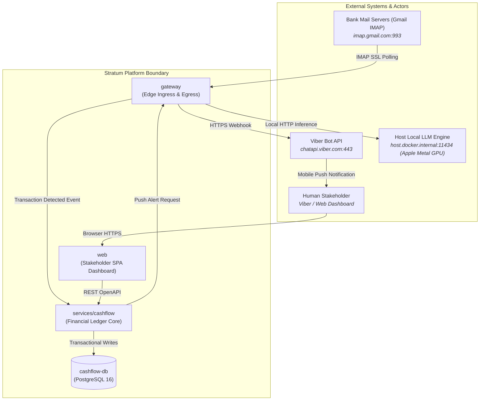
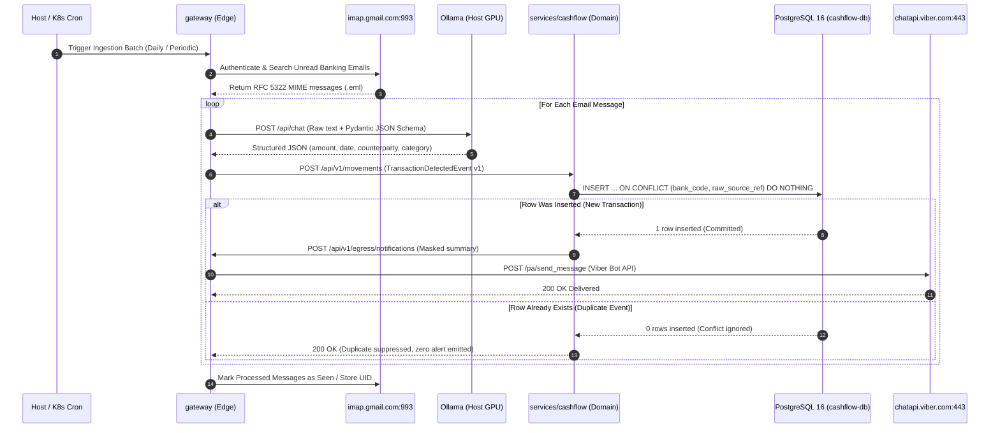

# 🌐 Stratum System Architecture Landscape

> **Document Type:** System Architecture Blueprint & Topology Specification  
> **Status:** `ACTIVE`  
> **Applies to:** Entire Stratum Ecosystem (`gateway`, `services/*`, `web`, `meta`)  
> **Governing Decisions:** [ADR-26j001](file:///Users/son/Projects/Stratum/stratum-meta/architecture/adrs/ADR-26j001-containerized-local-runtime.md), [ADR-26j002](file:///Users/son/Projects/Stratum/stratum-meta/architecture/adrs/ADR-26j002-strict-tdd-and-testcontainers.md), [ADR-26j003](file:///Users/son/Projects/Stratum/stratum-meta/architecture/adrs/ADR-26j003-local-llm-extraction-ollama.md), [ADR-26j004](file:///Users/son/Projects/Stratum/stratum-meta/architecture/adrs/ADR-26j004-ecosystem-technology-stack.md)

---

## 📌 1. Executive Architectural Summary

Stratum is a decoupled, containerized multi-repository platform designed for 100% autonomous AI engineering and operations. 

While **ADRs** document the *historical rationale* for isolated technical choices, this document provides the **holistic living landscape**: system context, network segmentation, container topology, bounded contexts, and inter-service communication protocols.

---

## 🗺️ 2. System Context (C4 Level 1: Context)



---

## 🧱 3. Container Topology & Network Segmentation (C4 Level 2)

Stratum enforces strict network isolation. Repositories run as independent OCI containers orchestrated via OrbStack / Docker Compose locally and Kubernetes manifests in production.

```
┌────────────────────────────────────────────────────────────────────────────────────────┐
│                              ORBSTACK / HOST OS (macOS)                                │
│                                                                                        │
│  ┌────────────────────────┐                                                            │
│  │ Ollama Daemon (Host)   │ :11434 (Host Metal GPU Inference - qwen2.5:32b / 36b MoE)  │
│  └───────────▲────────────┘                                                            │
│              │ (host.docker.internal)                                                  │
├──────────────┼─────────────────────────────────────────────────────────────────────────┤
│              │ PERIMETER NETWORK: stratum-perimeter-net                                │
│  ┌───────────┴────────────┐                                                            │
│  │ gateway                │                                                            │
│  │ (Python 3.12 / FastAPI)│                                                            │
│  │ Port: 8000             │                                                            │
│  └───────────┬────────────┘                                                            │
│              │ (Internal REST / Event Bus)                                             │
├──────────────┼─────────────────────────────────────────────────────────────────────────┤
│              │ INTERNAL SERVICES NETWORK: stratum-internal-net (NO PUBLIC INTERNET)     │
│  ┌───────────▼────────────┐                                ┌────────────────────────┐  │
│  │ services/cashflow      │ ◄─────── (REST API) ────────── │ web (Frontend SPA)     │  │
│  │ (Python 3.12 / FastAPI)│                                │ (React + Vite + Nginx) │  │
│  │ Port: 8001             │                                │ Port: 3000 / 5173      │  │
│  └───────────┬────────────┘                                └────────────────────────┘  │
│              │                                                                         │
├──────────────┼─────────────────────────────────────────────────────────────────────────┤
│              │ DATA NETWORK: stratum-data-net (ZERO EXTERNAL ACCESS)                   │
│  ┌───────────▼────────────┐                                                            │
│  │ cashflow-db            │                                                            │
│  │ (PostgreSQL 16)        │                                                            │
│  │ Port: 5432 (Internal)  │                                                            │
│  └────────────────────────┘                                                            │
└────────────────────────────────────────────────────────────────────────────────────────┘
```

### Network Isolation Invariants

| Network Tier | Services Attached | Ingress Allowed | Egress Allowed | Isolation Rule |
| :--- | :--- | :--- | :--- | :--- |
| **`stratum-perimeter-net`** | `gateway` | Stakeholder Webhooks | `imap.gmail.com:993`<br/>`chatapi.viber.com:443`<br/>`host.docker.internal:11434` | The ONLY network segment with outbound internet access. |
| **`stratum-internal-net`** | `gateway`, `services/cashflow`, `web` | `gateway`, `web` | Internal microservices only | **Zero public internet access.** Services cannot reach external hosts directly. |
| **`stratum-data-net`** | `services/cashflow`, `cashflow-db` | `services/cashflow` | None | Dedicated database segment. Database port `5432` is never published to host. |

---

## 📦 4. Bounded Contexts & Data Ownership

Stratum adheres to strict Domain-Driven Design (DDD) bounded contexts. **No service may directly query another service's database.**

```
┌──────────────────────────────────────────┐      ┌──────────────────────────────────────────┐
│        INGRESS & EGRESS BOUNDED CONTEXT  │      │       CASHFLOW LEDGER BOUNDED CONTEXT    │
│        (Repository: gateway)             │      │       (Repository: services/cashflow)    │
├──────────────────────────────────────────┤      ├──────────────────────────────────────────┤
│ • Raw MIME Parsing (RFC 5322)            │      │ • Double-entry / Movement Ledger         │
│ • Ollama Prompt Orchestration            │      │ • Account Balances & Reconciliations     │
│ • IMAP Mailbox State (UIDs, Seen flags)  │      │ • Financial Categories (Food, Fuel, ...) │
│ • Channel Formatting (Viber Markdown)    │      │ • Idempotency Gate (raw_source_ref)      │
│ • Zero persistent financial tables       │      │ • Authoritative PostgreSQL 16 DB         │
└──────────────────────────────────────────┘      └──────────────────────────────────────────┘
```

### Data Contract Boundary
All communication across bounded contexts passes strictly through canonical Pydantic v2 schemas defined in [**`contracts/`**](file:///Users/son/Projects/Stratum/stratum-meta/contracts):
* **`TransactionDetectedEvent` (v1):** Emitted by `gateway` upon extracting financial data; consumed by `services/cashflow`.
* **`NotificationRequest` (v1):** Emitted by `services/cashflow` when a new verified movement requires user alerting; dispatched by `gateway`.

---

## ⚡ 5. Data Flow & Communication Lifecycles

### Inbound Ingestion & Push Alert Pipeline (Daily Batch / Event-Driven)



---

## 🛡️ 6. Cross-Cutting Operational Invariants

### 6.1 Idempotency & Deduplication
* **Perimeter Ingress:** `gateway` tracks IMAP Message-ID and UID.
* **Domain Storage:** `services/cashflow` enforces a database-level composite unique constraint on `(bank_code, raw_source_ref)`. Even if `gateway` crashes and replays an email batch, zero duplicate records or duplicate alerts can ever occur.

### 6.2 Secret Management & 12-Factor Configuration
* No secrets, API tokens, or credentials may be committed to Git.
* Repositories read configuration strictly from environment variables validated at boot time via `pydantic-settings`.
* Local secrets reside in gitignored `.env.secret` files.

### 6.3 Observability & Telemetry
* **Structured Logging:** All services emit JSON-formatted logs to `stdout` containing: `timestamp`, `level`, `service`, `trace_id`, and `message`.
* **Health Probes:** Every container must expose `/healthz` (liveness) and `/readyz` (readiness) HTTP endpoints.
* **Network Isolation:** No external telemetry agents run inside the domain containers.

---

## 🗺️ 7. Architecture Mapping & Decision Traceability

| Architecture Requirement | Implementation Mechanism | Governing ADR |
| :--- | :--- | :--- |
| **Local Isolation & Parity** | OrbStack container virtualization, Compose networking | [ADR-26j001](file:///Users/son/Projects/Stratum/stratum-meta/architecture/adrs/ADR-26j001-containerized-local-runtime.md) |
| **Zero-Drift Automated Testing** | pytest + in-memory Tier 1 + Testcontainers PostgreSQL Tier 2 | [ADR-26j002](file:///Users/son/Projects/Stratum/stratum-meta/architecture/adrs/ADR-26j002-strict-tdd-and-testcontainers.md) |
| **Zero-Regex Freeform Parsing** | Local Ollama extraction using `qwen2.5:32b` / `36b MoE` via Metal GPU | [ADR-26j003](file:///Users/son/Projects/Stratum/stratum-meta/architecture/adrs/ADR-26j003-local-llm-extraction-ollama.md) |
| **Unified Polyglot-Free Stack** | Python 3.12+, Pydantic v2, FastAPI, PostgreSQL 16, Vite+React | [ADR-26j004](file:///Users/son/Projects/Stratum/stratum-meta/architecture/adrs/ADR-26j004-ecosystem-technology-stack.md) |
