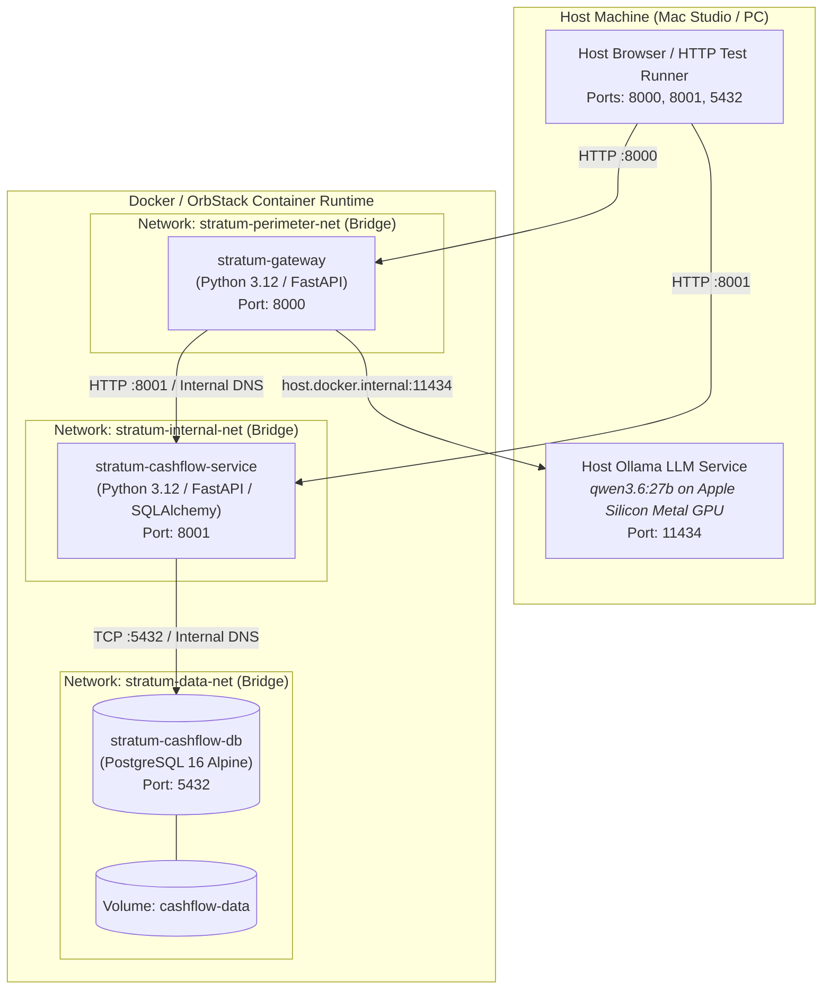

# 🐳 Stratum Living Container Runtime Topology (C4 Level 2)

> **Document Type:** Living Accumulated Container & Network Deployment Specification  
> **Status:** `ACTIVE` (Synchronized via `STEP-07` post-UAT promotion)  
> **Applies to:** Multi-Container Runtime (`gateway`, `services/cashflow`, `cashflow-db`)  
> **Source Orchestration:** [stratum-meta/deploy/docker-compose.yml](file:///Users/son/Projects/Stratum/stratum-meta/deploy/docker-compose.yml)  
> **Governing Decisions:** [ADR-26j001](file:///Users/son/Projects/Stratum/stratum-meta/architecture/adrs/ADR-26j001-containerized-local-runtime.md), [ADR-26j003](file:///Users/son/Projects/Stratum/stratum-meta/architecture/adrs/ADR-26j003-local-llm-extraction-ollama.md), [ADR-26j004](file:///Users/son/Projects/Stratum/stratum-meta/architecture/adrs/ADR-26j004-ecosystem-technology-stack.md)

---

## 🗺️ 1. Container & Network Deployment Diagram

---

## 🧱 2. Operational Container Inventory

| Container Name | Service Role | Image / Runtime | Network Memberships | Exposed Ports | Health Probe | Persistent State |
| :--- | :--- | :--- | :--- | :--- | :--- | :--- |
| [**`stratum-gateway`**](file:///Users/son/Projects/Stratum/gateway) | Perimeter Ingress & Egress Edge | `deploy-gateway` (Python 3.12) | `stratum-perimeter-net` `stratum-internal-net` | `8000:8000` | `GET /healthz` (Interval: 5s) | Stateless |
| [**`stratum-cashflow-service`**](file:///Users/son/Projects/Stratum/services/cashflow) | Financial Ledger Core Domain | `deploy-cashflow-service` (Python 3.12) | `stratum-internal-net` `stratum-data-net` | `8001:8001` | `GET /healthz` (Interval: 5s) | Stateless |
| **`stratum-cashflow-db`** | Relational Ledger Database | `postgres:16-alpine` | `stratum-data-net` | `5432:5432` | `pg_isready -U postgres` (Interval: 3s) | Named Volume: `cashflow-data` |

---

## 🌐 3. Network Isolation & Routing Invariants

Stratum enforces strict micro-segmentation across three isolated Docker bridge networks:

### 3.1 Perimeter Zone (`stratum-perimeter-net`)
* **Members:** `stratum-gateway` only.
* **Ingress:** External HTTP requests from the host (`localhost:8000`), webhook receivers.
* **Egress:**
  - Public Internet: Outbound IMAP over TLS (`imap.gmail.com:993`) and Viber Bot Webhook (`chatapi.viber.com:443`).
  - Host Bridge: `host.docker.internal:11434` for hardware-accelerated local LLM extraction.
* **Security Invariant:** **Zero direct routing to `stratum-cashflow-db`.** The perimeter edge cannot access the database under any circumstance.

### 3.2 Internal Mesh Zone (`stratum-internal-net`)
* **Members:** `stratum-gateway` and `stratum-cashflow-service`.
* **Traffic:** Authenticated synchronous REST calls using canonical JSON event contracts ([`contracts/events/transaction_detected.v1.json`](file:///Users/son/Projects/Stratum/stratum-meta/contracts/events/transaction_detected.v1.json)).
* **Security Invariant:** Isolated from the public Internet. External clients cannot route directly to internal service ports inside this network.

### 3.3 Data Storage Zone (`stratum-data-net`)
* **Members:** `stratum-cashflow-service` and `stratum-cashflow-db`.
* **Traffic:** PostgreSQL wire protocol (TCP port 5432) via `psycopg` connection pools.
* **Security Invariant:** Completely unreachable by `stratum-gateway` or external public traffic. Only domain services with explicit data network membership may establish database connections.

---

## ⚡ 4. Host Sidecar & Hardware Acceleration Bridge

Per [ADR-26j003](file:///Users/son/Projects/Stratum/stratum-meta/architecture/adrs/ADR-26j003-local-llm-extraction-ollama.md), local LLM inference executes directly on the host machine to leverage Apple Silicon Metal unified memory rather than virtualized container compute:

* **Host Endpoint:** `http://host.docker.internal:11434`
* **Docker Bridge Mechanism:** Configured via `extra_hosts: ["host.docker.internal:host-gateway"]` in [docker-compose.yml](file:///Users/son/Projects/Stratum/stratum-meta/deploy/docker-compose.yml).
* **Model Assigned:** `qwen3.6:27b` (27.8B parameter model loaded at 100% Metal GPU).
* **Timeouts & Sizing:** Client read timeout configured to `300.0s` to accommodate model cold loading and reasoning token generation without dropping requests.

---

## 💾 5. State Persistence & Data Integrity

| Volume / Mount | Type | Bound Container | Target Path | Backup & Retention |
| :--- | :--- | :--- | :--- | :--- |
| `cashflow-data` | Named Docker Volume | `stratum-cashflow-db` | `/var/lib/postgresql/data` | Authoritative financial ledger. Persists across `docker compose down` and stack rebuilds. |

---

## 🔄 6. Maintenance & Promotion Lifecycle

This specification is updated continuously as part of the SDLC at **`STEP-07`** (*Living Specifications Synchronization & Production Promotion*). 

Whenever a change request introduces a new microservice, persistent database, or network boundary, the delivery agent must update this document to reflect the expanded operational topology before closing the change.
