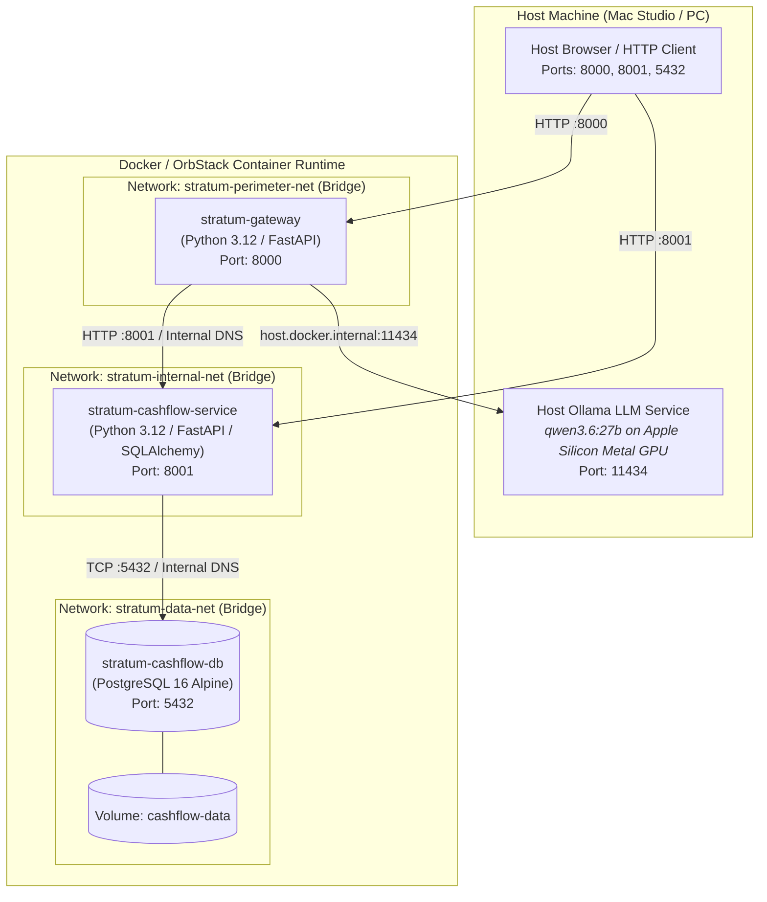

# 🐳 Stratum Living Container Runtime Topology (C4 Level 2)

> **Document Type:** Living Accumulated Container & Network Deployment Specification  
> **Status:** `ACTIVE` (Synchronized via `STEP-07` post-UAT promotion)  
> **Source Orchestration:** [stratum-meta/deploy/docker-compose.yml](file:///Users/son/Projects/Stratum/stratum-meta/deploy/docker-compose.yml)  
> **Governing Decisions:** [ADR-26j001](file:///Users/son/Projects/Stratum/stratum-meta/architecture/adrs/ADR-26j001-containerized-local-runtime.md), [ADR-26j003](file:///Users/son/Projects/Stratum/stratum-meta/architecture/adrs/ADR-26j003-local-llm-extraction-ollama.md), [ADR-26j004](file:///Users/son/Projects/Stratum/stratum-meta/architecture/adrs/ADR-26j004-ecosystem-technology-stack.md)

---

## 🗺️ 1. Visual Topology Diagram

---

## 🧱 2. Operational Runtime Matrix

| Container Name | Service Role | Image | Networks | Exposed Ports | Health Probe | Persistent State |
| :--- | :--- | :--- | :--- | :--- | :--- | :--- |
| [**`stratum-gateway`**](file:///Users/son/Projects/Stratum/gateway) | Perimeter Edge | `deploy-gateway` | `perimeter`, `internal` | `8000:8000` | `GET /healthz` (5s) | Stateless |
| [**`stratum-cashflow-service`**](file:///Users/son/Projects/Stratum/services/cashflow) | Financial Core | `deploy-cashflow` | `internal`, `data` | `8001:8001` | `GET /healthz` (5s) | Stateless |
| **`stratum-cashflow-db`** | Ledger Database | `postgres:16-alpine` | `data` | `5432:5432` | `pg_isready` (3s) | Named Volume: `cashflow-data` |

---

## 🛡️ 3. Core Architectural Invariants

* **Network Boundary Isolation:** `stratum-gateway` belongs strictly to `perimeter` and `internal` networks with **zero route to `stratum-cashflow-db`**.
* **Host Hardware Acceleration Bridge:** `stratum-gateway` reaches the host Metal GPU Ollama service strictly via `http://host.docker.internal:11434` (`extra_hosts`).
* **Authoritative State Isolation:** Only `stratum-cashflow-service` can access `cashflow-data` via internal TCP 5432; direct external SQL access is prohibited.
