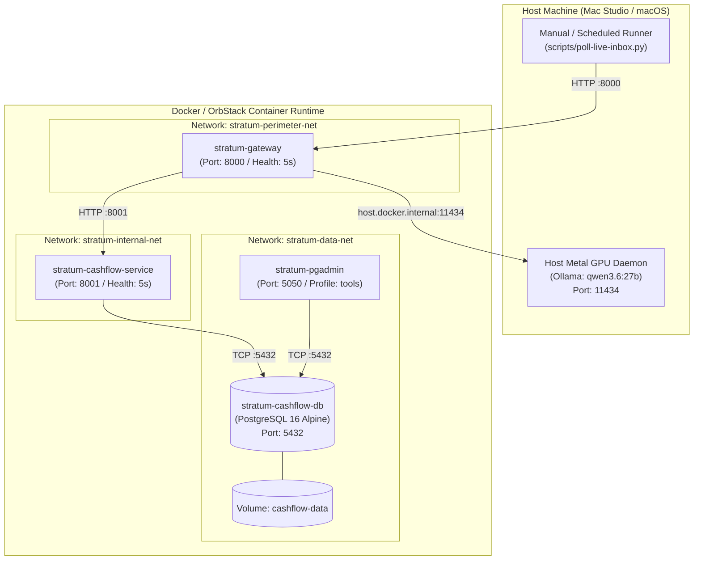

# 🚀 Stratum Continuous Container Operations & Cloud Readiness Guide (STEP-08)

> **Document Type:** Production Operations Runbook & Cloud Readiness Architecture  
> **Lifecycle Checkpoint:** SDLC `STEP-08: Continuous Container Operation & Cloud Readiness`  
> **Target Environment:** Local OrbStack / Docker Daemon & Future Cloud Runners (Kubernetes/ECS)  
> **Location:** `deploy/operations-guide.md`

---

## 📌 1. Operational Overview

Stratum executes as a fully containerized, microservice-based architecture with standard OCI containers and network-isolated bridge interfaces. In accordance with **SDLC STEP-08**, the platform runs continuously in the background on OrbStack with zero manual intervention required for service restarts or health maintenance.



---

---

## 🛠️ 2. Core Operational Runbook

All standard operational lifecycle tasks are consolidated into top-level `make` targets:

| Command | Action Performed | Expected Latency |
| :--- | :--- | :--- |
| `make up` | Starts host Ollama GPU daemon and boots the 3 core containers (`gateway`, `cashflow-service`, `cashflow-db`) until healthchecks pass. | < 10s |
| `make status` (or `make ps`) | Displays health status of all running containers, port mappings, and host Ollama GPU daemon. | < 1s |
| `make observer` | Runs a one-shot AI Observer probe, evaluates anomalies, appends telemetry, and prints terminal dashboard. | < 2s |
| `make observer-daemon` | Starts continuous autonomous AI Observer daemon (probes every 60s, alerts Telegram on anomalies). | Background |
| `make observer-review` | Uses local Ollama LLM to synthesize an executive Infrastructure Capacity & Upgrade Advisory report. | 5s - 15s |
| `make logs` | Streams live, unified container logs with color-coded service prefixes. | Real-time |
| `make backup-db` | Generates a timestamped, consistent SQL dump in `stratum-meta/backups/`. | < 3s |
| `make poll` | Runs the high-water mark IMAP poller, ingesting new bank alert emails and sending mobile Telegram alerts. | 1s - 15s |
| `make poll-quiet` | Runs the IMAP poller silently without sending mobile push notifications (ideal for backfills). | 1s - 15s |
| `make down` | Gracefully terminates all containers while preserving database volume state. | < 5s |

---

## 🤖 3. Autonomous AI Infrastructure Observer & Capacity Advisor

The **AI Observer** (`scripts/ai-observer.py`) operates as a self-contained monitoring and capacity planning engine. It addresses three continuous operational requirements:

### 3.1 Continuous Telemetry Probing
Samples real-time container metrics, latencies, and storage bounds:
* **Docker / OrbStack Container Footprints:** CPU % and Memory (MB used vs limit) via `docker stats`.
* **Container Health & Restarts:** Inspects Docker daemon state for `healthy`, `unhealthy`, and restart count increments.
* **HTTP Endpoint Latencies:** Measures roundtrip response times for `stratum-gateway:8000/healthz` and `stratum-cashflow-service:8001/healthz`.
* **Database Ledger Growth:** Queries PostgreSQL `cashflow` database size (`pg_database_size`) and row count in `account_movements`.
* **Host Ollama Metal GPU:** Probes model inference endpoint (`/api/tags`) and records response latency.
* **Persistent Storage:** All snapshots are appended to `stratum-meta/telemetry/observer-metrics.jsonl`.

### 3.2 Real-Time Anomaly Detection & Push Alerting
Every probe evaluates the system against defined operational invariants:

| Telemetry Dimension | Normal Invariant | Anomaly Trigger | Action / Alert Severity |
| :--- | :--- | :--- | :--- |
| **Container Status** | `running (healthy)` | `exited`, `unhealthy`, or `restarting` | 🚨 CRITICAL: Instant Telegram push alert |
| **Container Memory** | Microservices < 300 MB, DB < 500 MB | RAM > 500 MB (service) or > 1 GB (DB) | ⚠️ WARNING: Telegram push alert |
| **HTTP Health Latency** | Latency < 500ms | Latency > 3000ms or HTTP 5xx | ⚠️ WARNING: Telegram push alert |
| **PostgreSQL Health** | `pg_isready` exit code 0 | Non-zero exit code / unreachable | 🚨 CRITICAL: Instant Telegram push alert |
| **Ollama GPU Engine** | Responsive in < 100ms | Offline or Latency > 5000ms | ⚠️ WARNING: Telegram push alert |

* **Alert Suppression & Deduplication:** To prevent alert fatigue, active anomalies are tracked in `stratum-meta/.observer_alert_state.json`. Alerts are suppressed during a 15-minute cooldown unless an issue changes severity, and a green `✅ RESOLVED` notification is dispatched when the anomaly clears.

### 3.3 Periodic Review & Capacity Planning Advisor
Executing `make observer-review` (or running weekly/monthly scheduled reviews) prompts local Ollama (`qwen3.6:27b`):
1. Aggregates statistical metrics over the target evaluation window (P95/P99 latency, peak RAM, disk consumption growth rate).
2. Evaluates resource headroom against physical host constraints (Apple Silicon unified memory, CPU cores).
3. Produces a formal Markdown review report (`stratum-meta/reports/infrastructure_review_YYYYMMDD.md`) providing actionable recommendations:
   * Keep existing allocation (healthy headroom).
   * Adjust container memory/CPU limits.
   * Plan local hardware upgrade (RAM/GPU).
   * Plan cloud lift-and-shift to Kubernetes.

---

## 🛡️ 4. Log Hygiene & Storage Bounds

To ensure continuous operation without exhausting disk space on the host or OrbStack VM, all services in [`deploy/docker-compose.yml`](docker-compose.yml) enforce strict log caps:

```yaml
x-logging: &default-logging
  driver: "json-file"
  options:
    max-size: "10m"
    max-file: "3"
```
* **Maximum disk space per container:** 30 MB (3 files × 10 MB).
* **Automatic log pruning:** Rotated automatically by the Docker daemon using FIFO rotation.

---

## 💾 5. Data Durability & Backup Runbook

All transactional ledger data is stored in the persistent Docker named volume `cashflow-data`.

### Automated Backup
Run `make backup-db` at any time:
```bash
make backup-db
```
Outputs consistent snapshot to `stratum-meta/backups/cashflow_backup_YYYYMMDD_HHMMSS.sql`.

### Point-in-Time Restoration
To restore from a backup file:
```bash
# Drop & restore into running stratum-cashflow-db
docker exec -i stratum-cashflow-db psql -U postgres -d cashflow < stratum-meta/backups/cashflow_backup_YYYYMMDD_HHMMSS.sql
```

---

## ☁️ 6. Cloud Lift-and-Shift Readiness

Stratum architecture satisfies 100% of the 12-factor cloud-native criteria:

| Standard Dimension | Stratum Implementation | Cloud Portability Strategy |
| :--- | :--- | :--- |
| **OCI Compliance** | Standard multi-stage `Dockerfile` in `gateway` and `services/cashflow` using `python:3.12-slim`. | Direct push to Amazon ECR, Google Artifact Registry, or Docker Hub. |
| **Configuration & Secrets** | Loaded strictly via environment variables and `.env.secrets` (zero hardcoded secrets). | Direct mapping to Kubernetes Secrets / AWS Secrets Manager / GCP Secret Manager. |
| **Stateless Services** | `gateway` and `cashflow-service` store 0 persistent state in the container filesystem. | Horizontally scalable across multiple Kubernetes Pods. |
| **Stateful Persistence** | `account_movements` ledger isolated in PostgreSQL with foreign keys and unique constraints. | Drop-in replacement with managed AWS RDS PostgreSQL or Google Cloud SQL. |
| **Local LLM -> Cloud LLM** | `OLLAMA_HOST_URL` and `OLLAMA_MODEL` externalized in environment variables. | Swap to remote vLLM / Ollama instance or cloud LLM endpoint via config change. |
| **Health Probes** | `/healthz` endpoints conform to standard Kubernetes `livenessProbe` and `readinessProbe`. | Native Kubernetes ingress routing and zero-downtime rolling updates. |
