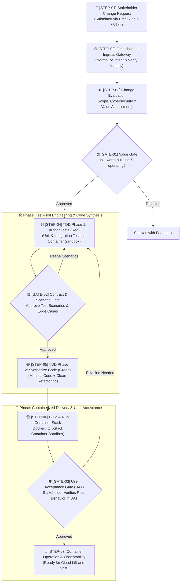

# 🔄 Stratum Universal Autonomous Workflow

> **Core Philosophy:** 100% AI-generated code, strict Test-Driven Development (TDD), and containerized portability—governed by three strategic Human-in-the-Loop review gates via **Email (`sonnormal@gmail.com`)**, **Zalo**, and **Viber**.
>
> *Scope & Applicability:* This workflow applies universally to **every change**—from initial platform setup (`CR-001`) to new microservices, features, refactoring, and bug fixes. Testing currently focuses on **Tier 1 (Unit Tests)** and **Tier 2 (Integration Tests with containerized dependencies)**.

---

## 🗺️ Visual Lifecycle Diagram

---

## 🏛️ The Three Human Governance Gates

Human oversight is concentrated at three strategic, high-leverage decision points:

| Gate | Name | Core Question | What the Human Inspects |
| :--- | :--- | :--- | :--- |
| **`GATE-01`** | **Value & Feasibility Gate** | *"Why do it & is it worth it?"* | Scope, cybersecurity (credentials, secrets, access control), and cost-benefit feasibility before any code is written. |
| **`GATE-02`** | **Contract & Test Scenario Gate** | *"What exact behavior to build?"* | Plain-language test scenarios and edge cases *before* implementation code is synthesized. |
| **`GATE-03`** | **User Acceptance Gate (UAT)** | *"Does it work in reality?"* | Live container execution with sample/real inputs, verifying persistence, APIs, and conversational notifications. |

---

## 📋 Universal Step-by-Step Breakdown

---

### Phase 1: Request Intake & Value Gate

#### `STEP-01`: Change Request Intake
* **Actor:** Human Stakeholder (via Email, Zalo, or Viber)
* **Input:** Natural language prompt describing a change, new service, bug fix, or integration.
* **Output:** Inbound raw message received by `stratum-gateway`.

#### `STEP-02`: Gateway Normalization & Identity Verification
* **Actor:** `stratum-gateway`
* **Process:** 
  1. Authenticates sender against allowed list (`sonnormal@gmail.com`, verified chat ID).
  2. Extracts intent, parameters, and attachments.
  3. Assigns a formal tracking ID (`CR-XXX`).
* **Output:** Normalized `ChangeRequestInitiatedEvent`.

#### `STEP-03`: Comprehensive Change Evaluation & Cybersecurity Assessment
* **Actor:** Strategic Evaluation Agent
* **Analysis Performed:**
  1. **Impact Analysis:** Affected repositories (`stratum-services/*`, `stratum-gateway`, `stratum-meta`), data schemas, and API contracts.
  2. **Cybersecurity & Secrets Assessment:** Authentication mechanisms, credentials/tokens management (zero hardcoded secrets), data sensitivity/masking, and attack surface.
  3. **Cost-Benefit Modeling:** Implementation compute effort vs. operational benefits.
* **Output:** Formatted Change Evaluation Report (saved to `changes/` per [CER Template](templates/change_evaluation_template.md)).

#### `GATE-01`: Review Gate 1 — Value & Feasibility Gate
* **Delivered to:** **Email**, **Zalo**, and **Viber**.
* **Human Action:** Stakeholder reviews scope, security posture, and business value.
* **Decisions:**
  * `[Approved: Worth It]` $\rightarrow$ Proceeds to `STEP-04`.
  * `[Rejected: Not Worth It]` $\rightarrow$ Shelves the change with justification.
  * `[Scope Revision]` $\rightarrow$ Prompts requester to constrain scope.

---

### Phase 2: Test-First Engineering & Code Synthesis

> **Testing Policy:** Only **Tier 1 (Unit)** and **Tier 2 (Integration)** tests are required during early development. External dependencies and databases use containerized test sandboxes (**Docker / Testcontainers**). Multi-service E2E automation is added when architecture stabilizes.

#### `STEP-04`: TDD Phase 1 — Test Specification & Scenario Authoring (Red)
* **Actor:** AI QA Agent
* **Process:** Synthesizes automated tests *before* writing application code:
  * **Unit Tests (Tier 1):** Domain business logic, mathematical/state transitions, parsing regex, boundary values, and edge cases.
  * **Integration Tests (Tier 2):** Database persistence, schema migrations, unique constraints, transactional rollbacks, and event bus emissions in an ephemeral container sandbox.
  * Confirms all new tests fail cleanly in sandbox (`Red` state).
* **Output:** Committed test suites in branch + formatted Test Scenario Checklist for human review.

#### `GATE-02`: Review Gate 2 — Contract & Test Scenario Gate
* **Delivered to:** **Email**, **Zalo**, and **Viber**.
* **Human Action:** Stakeholder reviews plain-language test scenarios and edge cases.
* **Decisions:**
  * `[Approve Scenarios]` $\rightarrow$ Advances to `STEP-05`.
  * `[Add / Refine Scenarios]` $\rightarrow$ Stakeholder adds missing real-world edge cases; QA Agent updates test suite.
  * `[Reject]` $\rightarrow$ Closes branch and terminates CR.

#### `STEP-05`: TDD Phase 2 — Autonomous Code Synthesis & Refactoring (Green & Refactor)
* **Actor:** AI Dev Agent
* **Process:**
  1. Synthesizes minimal code required to satisfy all approved tests (`Green`).
  2. Refactors algorithms, cleans architecture, and ensures structured logging without breaking tests.
  3. Validates that 100% of test assertions pass in the local sandbox.
* **Output:** Clean code PR with 100% green test suite.

---

### Phase 3: Containerized Delivery & User Acceptance

#### `STEP-06`: Container Build & Local UAT Deployment
* **Actor:** Delivery Agent
* **Process:**
  1. Builds standardized container image via `Dockerfile`.
  2. Launches container stack via `docker compose up -d` in **OrbStack / Docker**.
  3. Verifies container health checks (`/healthz` returns `200 OK`).
* **Output:** Operational local container stack ready for verification.

#### `GATE-03`: Review Gate 3 — User Acceptance Gate (UAT Sign-off)
* **Delivered to:** **Email**, **Zalo**, and **Viber**.
* **Human Action:** Stakeholder tests the feature live in the local UAT container environment (feeding real/sample data, clicking web UI, or testing chat bots).
* **Decisions:**
  * `[Accept & Sign Off]` $\rightarrow$ Feature accepted; advances to `STEP-07`.
  * `[Request Changes]` $\rightarrow$ Feedback notes provided; re-routes to `STEP-04`.
  * `[Reject / Abort]` $\rightarrow$ Reverts deployment.

#### `STEP-07`: Continuous Container Operation & Cloud Readiness
* **Actor:** Local Container Daemon / Future Cloud Runner
* **Process:**
  - Container runs stably in the background on OrbStack.
  - Architecture is 100% standard Docker—ready to be deployed to any cloud provider (AWS ECS, Fly.io, or Kubernetes) whenever 24/7 public access is needed.

---

## 🗃️ Change Tracking in `changes/`

All changes are archived in the `changes/` directory of `stratum-meta`. Every change folder or document records the complete lifecycle trail:
1. The **Change Evaluation Report** from `STEP-03` / `GATE-01`.
2. The **Approved Test Scenarios** from `STEP-04` / `GATE-02`.
3. The **UAT Sign-Off & Release Notes** from `STEP-06` / `GATE-03`.
