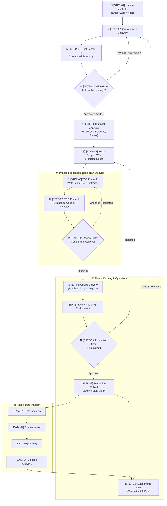

# 🔄 Stratum End-to-End Autonomous Workflow

> This document provides the complete, numbered step-by-step breakdown of how **Stratum** processes an idea or change request. It details the upfront cost-benefit analysis, multi-level impact assessment, decoupled repository specifications, Test-Driven Development (TDD) lifecycle, gated human approvals, and continuous runtime operations.

---

## 🗺️ Visual Architecture Diagram

---

## 📋 Quick Step Index

| Identifier | Step Name | Primary Actor | Key Purpose |
| :--- | :--- | :--- | :--- |
| **`STEP-01`** | **Human Request & Intake** | Human Stakeholder | Submit prompt, bug report, or change idea via Email (`sonnormal@gmail.com`), Zalo, or Viber |
| **`STEP-02`** | **Omnichannel Normalization** | `stratum-gateway` | Authenticate sender, extract intent/attachments, and emit normalized task event |
| **`STEP-03`** | **Cost-Benefit & Operational Analysis** | Orchestration Evaluator | Calculate implementation effort + ongoing operational TCO vs. expected business benefits |
| **`GATE-01`** | **Value & Feasibility Gate** | **Human Reviewer** | **Evaluate ROI and decide: Is this change worth implementing and operating?** |
| **`STEP-04`** | **Multi-Level Impact Analysis** | Architecture Agent | Analyze downstream impact on **Processes**, **Features/APIs**, and specific **Repositories** |
| **`STEP-05`** | **Repo-Scoped CRs & Isolated Specs** | Orchestrator Engine | Decompose change into standalone specifications and isolated CRs per repository |
| **`STEP-06`** | **TDD Phase 1: Test Specification (Red)** | AI QA Agent | Write 100% automated test suites *first* to define contracts before writing code |
| **`STEP-07`** | **TDD Phase 2: Code Synthesis (Green & Refactor)** | AI Dev Agent | Synthesize minimal code to satisfy tests, followed by automated clean refactoring |
| **`GATE-02`** | **Code & Test Review Gate** | **Human Reviewer** | Review code diffs, test logs, coverage, and schema documentation via Chat/Email |
| **`STEP-08`** | **Staging & Ephemeral Preview** | GitOps Agent | Apply declarative manifests to ephemeral preview/staging environment and run smoke tests |
| **`GATE-03`** | **Production Authorization Gate** | **Human Reviewer** | Inspect live preview environment, verify smoke test results, and approve production release |
| **`STEP-09`** | **Automated Production Rollout** | GitOps Engine | Execute zero-downtime progressive deployment (Canary / Blue-Green) with automated rollback |
| **`STEP-10`** | **Autonomous SRE Observability** | `stratum-aiops` | Continuously observe metrics, logs, traces, and synthetics; trigger automated RCA alerts |
| **`DATA-01`** | **Data Ingestion** | Ingestion Engine | Ingest continuous event streams, webhooks, and transactional data |
| **`DATA-02`** | **Data Transformation** | Transform Workers | Schema enforcement, validation, deduplication, and ELT/ETL transformations |
| **`DATA-03`** | **Data Delivery** | Delivery Workers | Sync transformed data into caches, data warehouses, and API models |
| **`DATA-04`** | **Data Digest & Analytics** | Digest Worker | Automated KPI aggregates, scheduled executive digests, and telemetry feedback |

---

## 🔍 Detailed Step-by-Step Breakdown

### Phase 1: Conversational Intake & Strategic Evaluation

#### `STEP-01`: Human Stakeholder Request & Intake
* **Actor:** Human Stakeholder (Owner, Engineer, or Product Lead)
* **Channel:** Email (`sonnormal@gmail.com`), **Zalo**, or **Viber**.
* **Input:** Natural language description of a requested change, feature request, bug fix, or performance enhancement.
* **Process:**
  - The stakeholder sends a prompt, email, or chat message with optional attachments (mockups, log snippets, architecture sketches).
* **Output:** Inbound conversational thread logged in `stratum-gateway`.

---

#### `STEP-02`: Omnichannel Gateway Normalization
* **Actor:** `stratum-gateway` service
* **Input:** Raw webhook payload from Zalo, Viber, or SMTP/IMAP email.
* **Process:**
  1. Authenticates the sender against authorized keys in `.stratum/channels.yaml`.
  2. Extracts intent, thread context, and attachments.
  3. Formats the request into a standard internal CloudEvent.
  4. Returns an instant acknowledgement to the sender via the originating channel.
* **Output:** Normalized `ChangeRequestInitiatedEvent`.

---

#### `STEP-03`: Cost-Benefit & Operational Feasibility Analysis
* **Actor:** `stratum-orchestrator` (Strategic Evaluation Agent)
* **Input:** `ChangeRequestInitiatedEvent`, current architecture documentation, repository graph, and production telemetry baseline.
* **Process:**
  1. **Implementation Cost Modeling:**
     - Computes estimated agent compute cycles, code complexity, required schema migrations, and potential regression risks.
  2. **Operational Cost Modeling (Ongoing TCO):**
     - Forecasts incremental runtime costs: compute, memory, DB storage, network egress, third-party API licensing, and operational maintenance overhead.
  3. **Business Benefit Assessment:**
     - Evaluates expected performance improvements, user experience impact, system resilience, revenue potential, or risk reduction.
  4. **Synthesis:**
     - Calculates ROI and assigns a feasibility score with an AI recommendation: `Recommended`, `Marginal / High Cost`, or `Not Recommended`.
* **Output:** Comprehensive **Cost-Benefit Evaluation (CBE) Report**.

---

### Phase 2: Upfront Value Gate & Multi-Level Impact Assessment

#### `GATE-01`: Review Gate 1 — Value & Feasibility Gate
* **Actor:** Human Reviewer (via conversational channel)
* **Trigger:** Completion of `STEP-03` CBE Report.
* **Notification Delivered:**
  - Sent to **Email** (`sonnormal@gmail.com`), **Zalo**, and **Viber**.
  - Displays: High-level change summary, implementation cost vs. ongoing operational cost, expected benefits, and AI recommendation.
* **Decisions:**
  * **Option A: `[Approved: Worth It]`** $\rightarrow$ Advances to **`STEP-04`** (Multi-Level Impact Analysis).
  * **Option B: `[Rejected: Not Worth It]`** $\rightarrow$ Shelves the change request, records the decision to the audit log, and notifies the requester with justification (preventing wasteful compute and codebase bloat).
  * **Option C: `[Scope Revision]`** $\rightarrow$ Prompts requester to constrain scope or modify acceptance criteria.

---

#### `STEP-04`: Multi-Level Impact Analysis
* **Actor:** Architecture & System Analysis Agent
* **Input:** Approved change request from `GATE-01`.
* **Process:** Conducts a deep, cross-cutting impact assessment across three distinct layers:
  1. **Process Impact:**
     - Identifies changes to business workflows, operational runbooks, administrative procedures, compliance policies, or CI/CD paths.
  2. **Feature Impact:**
     - Analyzes functional contracts, public API changes, backward compatibility, breaking schema updates, and user journey transitions.
  3. **Repository Impact:**
     - Identifies all affected repositories across the multi-repo catalog (`stratum-services/*`, `stratum-gateway`, `stratum-data-platform`, `stratum-infra`, `stratum-gitops`).
* **Output:** Multi-Level Impact Assessment Matrix.

---

#### `STEP-05`: Repo-Scoped Specifications & Isolated Change Requests
* **Actor:** `stratum-orchestrator`
* **Input:** Multi-Level Impact Assessment Matrix from `STEP-04`.
* **Process:**
  1. **Decoupled Decomposition:** Decomposes the macro change into independent, repository-specific change requests.
  2. **Dedicated Specifications:** Generates a standalone technical specification for each affected repository:
     - Exact API schemas / data contracts (OpenAPI, protobuf, AsyncAPI).
     - Expected behavioral contracts, mock interfaces, and dependency stubs.
  3. **Autonomous Isolation:** Ensures each repository can be developed, tested, and released independently without cross-repo compile-time dependencies or merge blockades.
* **Output:** Set of decoupled, repository-scoped CR tasks dispatched to respective agent worker queues.

---

### Phase 3: Test-Driven Development (TDD) Software Factory

> **Stratum strictly follows Test-Driven Development (TDD):** Automated tests are synthesized and executed *before* implementation code is written.

#### `STEP-06`: TDD Phase 1 — Test Specification & Authoring (Red)
* **Actor:** AI QA Agent (Specialized testing model)
* **Input:** Repository-scoped specification from `STEP-05`.
* **Process:**
  1. Creates an isolated feature branch in the target repository (e.g. `agent/cr-104-auth`).
  2. Synthesizes 100% automated test suites *first*:
     - **Unit Tests:** Boundary checks, input validation, logic assertions, edge cases.
     - **Integration Tests:** Database transactions, cache lookups, and message bus interactions with containerized mocks.
     - **Contract Tests:** Strict verification against OpenAPI / AsyncAPI schemas.
  3. Executes test suites in a clean sandbox container:
     - **Verification of "Red":** Confirms that tests fail cleanly for the right reasons before implementation exists.
* **Output:** Committed automated test suite defining the executable specification contract.

---

#### `STEP-07`: TDD Phase 2 — Implementation Code Synthesis & Refactoring (Green & Refactor)
* **Actor:** AI Dev Agent (Specialized coding model)
* **Input:** Failing test suites and technical specification from `STEP-06`.
* **Process:**
  1. **Make Tests Pass (Green):** Synthesizes the minimal, high-quality application code required to satisfy all failing tests.
  2. **Execution & Validation:** Re-runs test automation in the sandbox until 100% of test assertions pass.
  3. **Refactor:** Optimizes algorithms, eliminates redundancy, ensures idiomatic conventions, and updates documentation/type annotations without breaking tests.
  4. Generates a pull request with full test execution reports and diff summaries.
* **Output:** Clean code pull request with 100% green test suite in the target repository.

---

### Phase 4: Human Verification, Staging & Pre-Production

#### `GATE-02`: Review Gate 2 — Code, Test & Architecture Approval
* **Actor:** Human Reviewer (via conversational channel)
* **Trigger:** 100% test pass rate and clean lint/security audit in `STEP-07`.
* **Notification Delivered:**
  - Sent to **Email** (`sonnormal@gmail.com`), **Zalo**, and **Viber**.
  - Includes: Change summary, code diff link, test execution matrix, code coverage metrics, and interactive action buttons.
* **Decisions:**
  * **Option A: `[Approve]`** $\rightarrow$ Advances to **`STEP-08`** (Staging & Ephemeral Preview Deployment).
  * **Option B: `[Changes Requested]`** $\rightarrow$ Re-routes back to **`STEP-06`** (QA/Dev agents) with human guidance notes for autonomous revision.
  * **Option C: `[Reject]`** $\rightarrow$ Closes branch and records termination to audit log.

---

#### `STEP-08`: GitOps Staging & Ephemeral Preview Deployment
* **Actor:** GitOps Delivery Agent (`stratum-gitops`)
* **Input:** Approved pull request from `GATE-02`.
* **Process:**
  1. Triggers container build and image tagging.
  2. Updates declarative manifests in `stratum-gitops`.
  3. Deploys an isolated ephemeral preview environment or updates the staging cluster.
  4. Runs automated end-to-end smoke tests and synthetic transactions against the live running preview.
* **Output:** Verified preview environment with accessible endpoint URL and smoke test verification logs.

---

#### `GATE-03`: Review Gate 3 — Production Gate Approval
* **Actor:** Human Reviewer
* **Trigger:** Successful preview deployment and 100% pass on staging smoke tests.
* **Notification Delivered:**
  - Sent to **Email** (`sonnormal@gmail.com`), **Zalo**, and **Viber**.
  - Includes: Staging preview URL, smoke test verification summary, and automated rollback plan.
* **Decisions:**
  * **Option A: `[Approve Production]`** $\rightarrow$ Advances to **`STEP-09`** (Automated Production Rollout).
  * **Option B: `[Reject / Abort]`** $\rightarrow$ Tears down preview environment and returns to `STEP-05` or aborts rollout.

---

### Phase 5: Production Delivery, SRE & Data Lifecycle

#### `STEP-09`: Automated Production Rollout
* **Actor:** GitOps Delivery Engine (ArgoCD / Flux)
* **Input:** Signed production approval token from `GATE-03`.
* **Process:**
  1. Merges feature PR into `main`.
  2. Executes progressive delivery strategy (Canary or Blue-Green rollout).
  3. Shifts live traffic incrementally while monitoring real-time error rates and response latencies.
  4. Automatically triggers an immediate rollback if latency or error thresholds breach SLO limits.
* **Output:** Successfully released production version with zero downtime.

---

#### `STEP-10`: Autonomous SRE Observability & Telemetry
* **Actor:** `stratum-aiops` (Autonomous SRE Agent)
* **Input:** Continuous telemetry stream (OpenTelemetry traces, Prometheus metrics, structured logs, synthetic health probes).
* **Process:**
  1. Tracks golden signals: Latency, Traffic, Errors, and Saturation.
  2. Runs ML-driven anomaly detection to identify performance regressions or failure patterns.
  3. When an anomaly is detected:
     - Automatically isolates logs and traces to conduct Root Cause Analysis (RCA).
     - Synthesizes a diagnostic report and recommended remediation patch.
     - Dispatches real-time alerts back through `STEP-02` (Gateway) to **Email**, **Zalo**, and **Viber**.
* **Output:** Real-time health metrics, automated RCAs, and incident alerts.

---

### Parallel Stream: End-to-End Data Platform Lifecycle

#### `DATA-01`: Data Ingestion
* **Actor:** Data Pipeline Ingestion Service (`stratum-data-platform`)
* **Process:** Ingests raw data from external APIs, webhooks, transaction databases, and event streaming brokers (Kafka/RabbitMQ).
* **Output:** Raw partitioned data landing zones with event validation.

#### `DATA-02`: Data Transformation
* **Actor:** Transformation Engine (dbt / stream processing workers)
* **Process:** Applies schema enforcement, deduplication, business logic transformations, and data quality assertions.
* **Output:** Curated, query-optimized datasets and dimensional models.

#### `DATA-03`: Data Delivery
* **Actor:** Delivery Engine
* **Process:** Distributes transformed data to consumer endpoints: analytical data warehouses, operational cache stores, and downstream microservice databases.
* **Output:** Ready-to-query synchronized operational state.

#### `DATA-04`: Data Digest & Analytics
* **Actor:** Autonomous Digest Worker
* **Process:** Computes aggregated KPIs, monitors trends, and compiles scheduled business & operational digests dispatched directly to stakeholder channels. Feeds continuous quality metrics back into `STEP-10` (AIOps).
* **Output:** Executive & operational summary reports delivered to Email and Chat.
