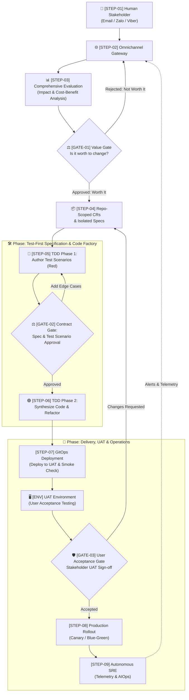

# 🔄 Stratum End-to-End Autonomous Workflow

> This document provides the complete, numbered step-by-step breakdown of how **Stratum** processes an idea or change request. It details the upfront comprehensive change evaluation (unifying impact analysis and cost-benefit feasibility), the 3 strategic Human-in-the-Loop governance gates (**Value Gate**, **Spec & Test Scenario Gate**, and **User Acceptance Gate**), Test-Driven Development (TDD), and continuous production operations.
> 
> *Note: Data services, event pipelines, and background processing are treated as standard repositories/features contributing to specific business processes and user experiences, governed by this exact same unified lifecycle.*

---

## 🗺️ Visual Architecture Diagram

---

## 🏛️ The Three Human Governance Gates

Stratum divides human governance into three distinct, high-leverage checkpoints:

| Gate | Checkpoint Name | Question Answered | What Human Inspects |
| :--- | :--- | :--- | :--- |
| **`GATE-01`** | **Value & Feasibility Gate** | *"Why do it & is it worth it?"* | Impact on processes/features/repos + Implementation cost + Ongoing operational TCO vs. Business ROI |
| **`GATE-02`** | **Contract & Test Scenario Gate** | *"What exact behavior will be built?"* | API schema diffs + Human-readable test scenarios (positive paths, error conditions, edge cases) |
| **`GATE-03`** | **User Acceptance Gate (UAT)** | *"Does it work as intended for the user?"* | Live application in UAT environment + test bots on Zalo/Viber $\rightarrow$ Final Production Sign-off |

---

## 📋 Quick Step Index

| Identifier | Step Name | Primary Actor | Key Purpose |
| :--- | :--- | :--- | :--- |
| **`STEP-01`** | **Human Request & Intake** | Human Stakeholder | Submit prompt, bug report, or change idea via Email (`sonnormal@gmail.com`), Zalo, or Viber |
| **`STEP-02`** | **Omnichannel Normalization** | `stratum-gateway` | Authenticate sender, extract intent/attachments, and emit normalized task event |
| **`STEP-03`** | **Comprehensive Change Evaluation** | Strategic Evaluation Agent | Deep **Impact Analysis** (Processes, Features, Repos) + **Cybersecurity** + **Cost-Benefit Analysis**. Generates [CER Report](templates/change_evaluation_template.md) |
| **`GATE-01`** | **Value & Feasibility Gate** | **Human Reviewer** | **Decide if the change is worth implementing and operating based on ROI** |
| **`STEP-04`** | **Repo-Scoped CRs & Isolated Specs** | Orchestrator Engine | Decompose change into standalone specifications and isolated CRs per repository (Domain, Data, Platform) |
| **`STEP-05`** | **TDD Phase 1: Test Specification & Authoring (Red)** | AI QA Agent | Write 100% automated test suites *first* to define executable contracts before writing code |
| **`GATE-02`** | **Contract & Test Scenario Gate** | **Human Reviewer** | **Review and approve API contracts and test scenarios (edge cases) before any implementation code is synthesized** |
| **`STEP-06`** | **TDD Phase 2: Autonomous Code Synthesis (Green & Refactor)** | AI Dev Agent | Autonomously synthesize minimal code to satisfy approved tests, followed by clean refactoring |
| **`STEP-07`** | **Deployment to UAT & Smoke Check** | GitOps Agent | Deploy release candidate to **User Acceptance Testing (UAT)** environment and verify basic health smoke checks |
| **`GATE-03`** | **User Acceptance Gate (UAT Sign-off)** | **Human Stakeholder** | **Stakeholder tests functionality live in UAT environment to grant final production rollout sign-off** |
| **`STEP-08`** | **Automated Production Rollout** | GitOps Engine | Execute zero-downtime progressive deployment (Canary / Blue-Green) with automated smoke verification & rollback |
| **`STEP-09`** | **Autonomous SRE Observability** | `stratum-aiops` | Continuously observe live telemetry, synthetic probes, and anomalies; trigger automated RCA alerts |

---

## 🔍 Detailed Step-by-Step Breakdown

### Phase 1: Conversational Intake & Comprehensive Evaluation

#### `STEP-01`: Human Stakeholder Request & Intake
* **Actor:** Human Stakeholder (Owner, Engineer, or Product Lead)
* **Channel:** Email (`sonnormal@gmail.com`), **Zalo**, or **Viber**.
* **Input:** Natural language description of a requested change, feature request, bug fix, or performance enhancement.
* **Process:**
  - Stakeholder sends a prompt, email, or chat message with optional attachments (mockups, log snippets, architecture sketches).
* **Output:** Inbound conversational thread logged in `stratum-gateway`.

---

#### `STEP-02`: Omnichannel Gateway Normalization
* **Actor:** `stratum-gateway` service
* **Input:** Raw webhook payload from Zalo, Viber, or SMTP/IMAP email.
* **Process:**
  1. Authenticates the sender against authorized keys in `.stratum/channels.yaml`.
  2. Extracts intent, thread context, and attachments.
  3. Formats the request into a standard internal CloudEvent.
  4. Returns an instant acknowledgement to the sender via the originating channel.
* **Output:** Normalized `ChangeRequestInitiatedEvent`.

---

#### `STEP-03`: Comprehensive Change Evaluation (Impact, Security & Cost-Benefit)
* **Actor:** `stratum-orchestrator` (Strategic Evaluation & Architecture Agent)
* **Input:** `ChangeRequestInitiatedEvent`, current architecture documentation, repository topology, and production telemetry baseline.
* **Template Used:** Standardized output conforming to [`docs/templates/change_evaluation_template.md`](templates/change_evaluation_template.md).
* **Unified Evaluation Process:**
  1. **Multi-Level Impact Analysis:**
     - **Process Impact:** Identifies changes to business workflows, operational runbooks, administrative procedures, compliance policies, or CI/CD pipelines.
     - **Feature & Contract Impact:** Analyzes functional contracts, public API changes, backward compatibility, breaking schema updates, and user journey transitions.
     - **Repository Impact:** Maps exact changes to affected repositories (`stratum-services/*`, `stratum-gateway`, `stratum-data-platform`, `stratum-infra`, `stratum-gitops`).
  2. **Cybersecurity & Threat Assessment:**
     - **Threat Modeling (STRIDE):** Evaluates identity spoofing, data tampering, information leaks, DoS, and privilege escalation.
     - **Ingress & Access Control:** Verifies authentication mechanisms, role scopes (least privilege), public attack surfaces, and prompt injection defenses.
     - **Data Privacy & Secrets:** Classifies PII/confidential data, checks TLS/at-rest encryption standards, and confirms zero hardcoded secrets.
     - **Supply Chain Hygiene:** Validates third-party package dependencies against known CVE vulnerabilities.
  3. **Implementation Cost Modeling:**
     - Computes estimated agent compute cycles, code complexity, required schema migrations, and potential regression risks based on the repository impact findings.
  4. **Operational Cost Modeling (Ongoing TCO):**
     - Forecasts incremental runtime costs: compute, memory, DB storage, network egress, third-party API licensing, and operational maintenance overhead.
  5. **Business Benefit Assessment & ROI Calculation:**
     - Evaluates expected performance improvements, user experience impact, system resilience, revenue potential, or risk mitigation.
     - Computes net ROI verdict formula: $\text{Net Value} = (\text{Benefits} + \text{Risk Mitigation}) - (\text{Implementation Effort} + \text{3-Year Operational TCO})$.
* **Output:** Comprehensive **Change Evaluation Report (CER)** formatted per [`docs/templates/change_evaluation_template.md`](templates/change_evaluation_template.md).

---

### Phase 2: Upfront Value Gate & Decoupled Repository Decomposition

#### `GATE-01`: Review Gate 1 — Value & Feasibility Gate
* **Actor:** Human Reviewer (via conversational channel)
* **Trigger:** Completion of `STEP-03` CER Report.
* **Notification Delivered:**
  - Sent to **Email** (`sonnormal@gmail.com`), **Zalo**, and **Viber**.
  - Displays: High-level change summary, process/feature/repo impact summary, cybersecurity assessment flags, implementation vs. ongoing operational TCO, and AI strategic recommendation.
* **Decisions:**
  * **Option A: `[Approved: Worth It]`** $\rightarrow$ Advances to **`STEP-04`** (Repo-Scoped Specifications & Isolated CRs).
  * **Option B: `[Rejected: Not Worth It]`** $\rightarrow$ Shelves the change request, records the decision to the audit log, and notifies the requester with justification (preventing wasteful compute and codebase bloat).
  * **Option C: `[Scope Revision]`** $\rightarrow$ Prompts requester to constrain scope or modify acceptance criteria based on high-cost drivers identified in the report.

---

#### `STEP-04`: Repo-Scoped Specifications & Isolated Change Requests
* **Actor:** `stratum-orchestrator`
* **Input:** Approved Change Evaluation Report from `GATE-01`.
* **Process:**
  1. **Decoupled Decomposition:** Decomposes the macro change into independent, repository-specific change requests based on the impact matrix from `STEP-03`.
     - *Applies equally to domain services, data pipelines/streams, and platform integrations.*
  2. **Dedicated Specifications:** Generates a standalone technical specification for each affected repository:
     - Exact API schemas / data contracts (OpenAPI, protobuf, AsyncAPI).
     - Expected behavioral contracts, mock interfaces, and dependency stubs.
  3. **Autonomous Isolation:** Ensures each repository can be developed, tested, and released independently without cross-repo compile-time dependencies or merge blockades.
* **Output:** Set of decoupled, repository-scoped CR tasks dispatched to respective agent worker queues.

---

### Phase 3: Test-First Specification & Code Factory

> **Stratum strictly follows Test-Driven Development (TDD):** Automated tests are synthesized and human-approved *before* implementation code is written. For the detailed testing pyramid, execution topology (Local Runner vs. Cloud UAT), and Testcontainers patterns, see [`docs/testing_strategy.md`](testing_strategy.md).

#### `STEP-05`: TDD Phase 1 — Test Specification & Scenario Authoring (Red)
* **Actor:** AI QA Agent (Specialized testing model)
* **Input:** Repository-scoped specification from `STEP-04`.
* **Process:**
  1. Creates an isolated feature branch in the target repository (e.g. `agent/cr-104-auth` or `agent/cr-104-datapipeline`).
  2. Synthesizes 100% automated test suites:
     - **Happy Path Scenarios:** Verifying primary user journeys and business flows.
     - **Boundary & Edge Cases:** Zero values, extreme ranges, character limits, localization/format variations.
     - **Error & Fault Scenarios:** Invalid tokens, timeout handling, database failure simulations.
     - **Security & Authorization Assertions:** Access control barriers, injection inputs, unauthenticated rejections.
  3. Confirms that all newly authored tests fail cleanly in sandbox (`Red` state).
  4. Generates a **Human-Readable Test Scenario Summary** (in plain language bullet points).
* **Output:** Committed test suites in branch and formatted Test Scenario Summary for human review.

---

#### `GATE-02`: Review Gate 2 — Contract & Test Scenario Gate
* **Actor:** Human Reviewer (via conversational channel)
* **Trigger:** Completion of `STEP-05` test authoring in sandbox.
* **Why this gate is critical:**
  - **High Leverage:** Reviewing 10–15 plain-language test scenarios takes 60 seconds and guarantees that the AI builds the *exact right thing*.
  - **Eliminates Wasted AI Compute:** Prevents the AI Dev Agent from generating hundreds of lines of code based on a misunderstood assumption.
* **Notification Delivered:**
  - Sent to **Email** (`sonnormal@gmail.com`), **Zalo**, and **Viber**.
  - Displays: Target repository name, API schema contract diff, and the bulleted list of test scenarios (Positive, Edge cases, Errors, Security).
* **Decisions:**
  * **Option A: `[Approve Scenarios]`** $\rightarrow$ Advances immediately to **`STEP-06`** (AI synthesizes code to satisfy tests).
  * **Option B: `[Add / Refine Scenarios]`** $\rightarrow$ Human replies with missing edge cases (e.g., *"Also test what happens if the phone number has +84 format"*); QA Agent appends new tests and updates the suite.
  * **Option C: `[Reject]`** $\rightarrow$ Closes branch and terminates CR.

---

#### `STEP-06`: TDD Phase 2 — Autonomous Code Synthesis & Refactoring (Green & Refactor)
* **Actor:** AI Dev Agent (Specialized coding model)
* **Input:** Approved test suites and technical specification from `GATE-02`.
* **Process:**
  1. **Make Tests Pass (Green):** Synthesizes the minimal, high-quality application code required to satisfy all approved failing tests.
  2. **Execution & Validation:** Re-runs test automation in the sandbox until 100% of test assertions pass.
  3. **Refactor:** Optimizes algorithms, eliminates redundancy, ensures idiomatic conventions, and updates documentation/type annotations without breaking tests.
  4. Prepares pull request and artifacts for UAT deployment.
* **Output:** Clean code pull request with 100% green test suite in the target repository.

---

### Phase 4: Delivery to UAT & User Acceptance Gate

#### `STEP-07`: GitOps Deployment to UAT Environment & Smoke Check
* **Actor:** GitOps Delivery Agent (`stratum-gitops`)
* **Input:** Verified green pull request from `STEP-06`.
* **Environment Characteristics (UAT - User Acceptance Testing):**
  - **High-Fidelity Mirror:** Stable environment configured with production-parity topology and realistic (sanitized/anonymized) test data.
  - **Connected Channels:** Wired to test chat bots (Zalo, Viber) and email test aliases to allow natural end-to-end user interaction.
* **Process:**
  1. Builds and tags container images for all updated repositories.
  2. Updates declarative Kubernetes manifests in `stratum-gitops` targeting the UAT environment overlay.
  3. Deploys updated workloads to the UAT cluster.
  4. Runs automated startup readiness probes and lightweight smoke pings to ensure basic connectivity (DB, cache, ingress).
* **Output:** Live, operational UAT environment with accessible URLs and active chat/email webhooks ready for stakeholder testing.

---

#### `GATE-03`: Review Gate 3 — User Acceptance Gate (UAT Sign-off)
* **Actor:** Human Stakeholder / Product Owner (via conversational channel)
* **Trigger:** Successful deployment to UAT environment in `STEP-07`.
* **Notification Delivered:**
  - Sent to **Email** (`sonnormal@gmail.com`), **Zalo**, and **Viber**.
  - Displays:
    - **UAT Web Access Link:** URL to the running application in the UAT environment.
    - **UAT Bot Handles:** Test bot accounts on Zalo/Viber for verifying conversational features.
    - **Test Account Credentials & Seed Data Context.**
    - **Change Summary & Acceptance Criteria Checklist.**
* **User Acceptance Testing (UAT) Process:**
  - The stakeholder interacts with the feature directly in the UAT environment (clicking web UI, sending test chat commands, verifying reports).
* **Decisions:**
  * **Option A: `[Accept & Sign Off Production]`** $\rightarrow$ Feature is accepted; advances immediately to **`STEP-08`** (Automated Production Rollout).
  * **Option B: `[Request UAT Changes]`** $\rightarrow$ Stakeholder provides feedback notes describing discrepancies; re-routes back to **`STEP-04`** for autonomous agent revision.
  * **Option C: `[Reject / Abort]`** $\rightarrow$ Reverts UAT deployment and closes the change request.

---

### Phase 5: Production Delivery, SRE & Closed-Loop Operations

#### `STEP-08`: Automated Production Rollout
* **Actor:** GitOps Delivery Engine (ArgoCD / Flux)
* **Input:** Cryptographically signed production approval token from `GATE-03`.
* **Process:**
  1. Merges feature PR into `main`.
  2. Executes progressive delivery strategy (Canary or Blue-Green rollout) directly on the Production cluster.
  3. Runs automated production smoke tests during canary traffic shifting (10% $\rightarrow$ 25% $\rightarrow$ 50% $\rightarrow$ 100%).
  4. Automatically triggers an immediate rollback if error rates or latency breach SLO thresholds.
* **Output:** Successfully released production version with zero downtime.

---

#### `STEP-09`: Autonomous SRE Observability & Telemetry
* **Actor:** `stratum-aiops` (Autonomous SRE Agent)
* **Input:** Continuous live production telemetry stream (OpenTelemetry traces, Prometheus metrics, structured logs, synthetic heartbeat probes).
* **Process:**
  1. Tracks golden signals: Latency, Traffic, Errors, and Saturation in real time.
  2. Runs ML-driven anomaly detection to identify performance regressions, memory leaks, or failure patterns.
  3. Continuously executes 24/7 synthetic canary transactions to verify external network routes, DNS, and SSL certs.
  4. When an anomaly is detected:
     - Automatically isolates logs and traces to conduct Root Cause Analysis (RCA).
     - Synthesizes a diagnostic report and recommended remediation patch.
     - Dispatches real-time alerts back through `STEP-02` (Gateway) to **Email**, **Zalo**, and **Viber**.
* **Output:** Real-time health metrics, automated RCAs, and incident alerts.
