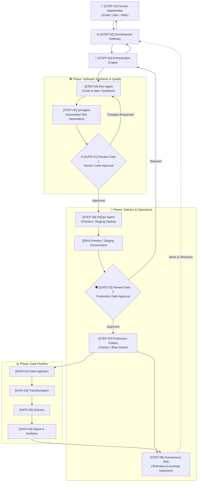

# 🔄 Stratum End-to-End Autonomous Workflow

> This document provides the complete, numbered step-by-step breakdown of how **Stratum** processes an idea or change request from initial conversational intake all the way through autonomous implementation, automated validation, gated approvals, production deployment, and self-observing runtime operations.

---

## 🗺️ Visual Architecture Diagram

---

## 📋 Quick Step Index

| Identifier | Step Name | Primary Actor | Key Purpose |
| :--- | :--- | :--- | :--- |
| **`STEP-01`** | **Human Intake & Change Request** | Human Stakeholder | Submit prompt, bug report, or feature request via Email / Zalo / Viber |
| **`STEP-02`** | **Omnichannel Normalization** | `stratum-gateway` | Authenticate sender, extract intent, and produce normalized event |
| **`STEP-03`** | **Orchestration & Task Decomposition** | `stratum-orchestrator` | Decompose goal into dependency graph and assign to agent pools |
| **`STEP-04`** | **AI Code & Specification Synthesis** | AI Dev Agent | Generate 100% of application code, API schemas, and documentation |
| **`STEP-05`** | **Automated Test Generation & Sandbox Execution** | AI QA Agent | Synthesize 100% automated test suite; execute in sandbox container |
| **`GATE-01`** | **Review Gate 1: Code & Architecture Approval** | Human Reviewer | Inspect proposed changes, test reports, and diffs via chat/email |
| **`STEP-06`** | **Staging & Ephemeral Preview Deployment** | GitOps Agent | Apply declarative configs to staging/preview Kubernetes environment |
| **`GATE-02`** | **Review Gate 2: Production Approval Gate** | Human Reviewer | Inspect staging smoke test verification and authorize production rollout |
| **`STEP-07`** | **Automated Production Rollout** | GitOps / CI/CD Engine | Progressive zero-downtime release (Blue-Green or Canary rollout) |
| **`STEP-08`** | **Autonomous SRE Observability** | `stratum-aiops` | Continuously observe metrics, logs, traces, and synthetic probes |
| **`DATA-01`** | **Data Ingestion** | Data Pipeline Ingest | Continuous streaming and batch ingestion from events, DBs, and APIs |
| **`DATA-02`** | **Data Transformation** | Data Pipeline Transform | ELT/ETL cleansing, schema validation, and event stream processing |
| **`DATA-03`** | **Data Delivery** | Data Pipeline Delivery | Sync transformed data into caches, data warehouses, and API models |
| **`DATA-04`** | **Data Digest & Insights** | Data Pipeline Digest | Generate automated analytical summaries, KPI reports, and telemetry |

---

## 🔍 Detailed Step-by-Step Breakdown

### Phase 1: Conversational Intake & Task Orchestration

#### `STEP-01`: Human Stakeholder Request & Intake
* **Actor:** Human Stakeholder (Project Owner, Engineer, or Business User)
* **Channel:** Email (`sonnormal@gmail.com`), **Zalo**, or **Viber**.
* **Input:** Natural language description of a new feature, bug report, performance improvement, or architectural change.
* **Process:**
  - Stakeholder messages the Stratum bot or emails the inbox.
  - Multi-modal attachments (screenshots, log files, design drafts) are accepted and attached to the message thread.
* **Output:** Inbound conversational message thread.

---

#### `STEP-02`: Omnichannel Gateway Normalization
* **Actor:** `stratum-gateway` service
* **Input:** Inbound webhook payloads from Zalo Bot API, Viber Bot API, or SMTP/IMAP email.
* **Process:**
  1. Validates sender authorization against `.stratum/channels.yaml`.
  2. Extracts intent, thread context, and message attachments.
  3. Translates raw chat/email messages into a standard internal CloudEvent schema.
  4. Dispatches an immediate confirmation acknowledgement back to the sender.
* **Output:** Normalized `TaskIntentEvent` sent to the Orchestration Engine.

---

#### `STEP-03`: Agent Orchestration & Task Decomposition
* **Actor:** `stratum-orchestrator` (Autonomous Brain)
* **Input:** `TaskIntentEvent` from the gateway.
* **Process:**
  1. Retrieves existing repository context, architecture decision records, and API contracts.
  2. Synthesizes an execution plan: decomposes the request into discrete subtasks (Code changes, Test authoring, Schema updates, Docs).
  3. Determines affected microservices (`stratum-services/*`, `stratum-data-platform`, etc.).
  4. Dispatches task orders to specialized agent worker queues.
* **Output:** Stateful task graph with assigned agent responsibilities.

---

### Phase 2: Software Factory (Synthesis & Verification)

#### `STEP-04`: AI Dev Agent — Code & Spec Synthesis
* **Actor:** AI Dev Agent (Specialized coding model instance)
* **Input:** Assigned subtask specification and scoped repository context.
* **Process:**
  1. Creates an isolated feature branch (e.g. `agent/feature-user-auth`).
  2. Synthesizes 100% of domain business code adhering to ecosystem coding standards.
  3. Updates OpenAPI / AsyncAPI schema specifications and documentation artifacts.
  4. Runs linting and static analysis to guarantee zero syntax or typing errors.
* **Output:** Git commit and draft pull request with code and updated technical artifacts.

---

#### `STEP-05`: AI QA Agent — Automated Test Generation & Execution
* **Actor:** AI QA Agent (Specialized testing model instance)
* **Input:** Newly synthesized code and PR diff from `STEP-04`.
* **Process:**
  1. Generates 100% automated test suites:
     - Unit tests for edge cases, boundaries, and validation rules.
     - Integration tests verifying database and external API contract interactions.
     - End-to-end (E2E) workflow tests simulating user journeys.
  2. Executes all test suites in an isolated ephemeral test sandbox.
  3. Generates code coverage and performance benchmark reports.
* **Output:** Fully automated test suite committed to the branch, accompanied by test execution logs and verification metrics.

---

### Phase 3: Human-in-the-Loop Governance Checkpoint 1

#### `GATE-01`: Review Gate 1 — Human Code & Architecture Approval
* **Actor:** Human Reviewer (via conversational channel)
* **Trigger:** QA tests pass with 100% success rate in sandbox.
* **Notification Delivered:**
  - Sent to **Email** (`sonnormal@gmail.com`), **Zalo**, and **Viber**.
  - Includes: High-level change summary, PR diff link, test pass/fail metrics, and interactive action buttons.
* **Decisions:**
  * **Option A: `[Approve]`** $\rightarrow$ Advances immediately to **`STEP-06`** (Staging & Ephemeral Preview Deployment).
  * **Option B: `[Changes Requested]`** $\rightarrow$ Re-routes back to **`STEP-04`** (Dev Agent) with human feedback notes for autonomous refinement.
  * **Option C: `[Reject]`** $\rightarrow$ Terminates execution, closes branch, and logs reason to audit trail.

---

### Phase 4: Staging, Pre-Production Gate & Delivery

#### `STEP-06`: GitOps Staging & Ephemeral Preview Deployment
* **Actor:** GitOps Delivery Agent (`stratum-gitops`)
* **Input:** Approved pull request from `GATE-01`.
* **Process:**
  1. Triggers automated CI pipeline: builds and tags container images.
  2. Updates declarative Kubernetes manifests / Helm charts in `stratum-gitops`.
  3. Spins up an ephemeral preview environment or updates the staging cluster.
  4. Executes automated smoke tests and health checks against the running staging workload.
* **Output:** Running staging environment with an accessible preview URL and automated health report.

---

#### `GATE-02`: Review Gate 2 — Production Gate Approval
* **Actor:** Human Reviewer
* **Trigger:** Successful deployment and healthy smoke checks in preview/staging environment.
* **Notification Delivered:**
  - Dispatched to **Email** (`sonnormal@gmail.com`), **Zalo**, and **Viber**.
  - Includes: Preview URL, smoke test report, performance baseline comparison, and rollback plan.
* **Decisions:**
  * **Option A: `[Approve]`** $\rightarrow$ Advances to **`STEP-07`** (Automated Production Rollout).
  * **Option B: `[Reject / Abort]`** $\rightarrow$ Re-routes back to **`STEP-03`** (Orchestrator) to cancel the rollout and tear down the preview environment.

---

#### `STEP-07`: Automated Production Rollout
* **Actor:** GitOps Delivery Engine (ArgoCD / Flux)
* **Input:** Cryptographic approval token from `GATE-02`.
* **Process:**
  1. Merges feature PR into `main` branch.
  2. Initiates progressive rollout (Canary or Blue-Green deployment strategy).
  3. Automatically shifts traffic from active version to new version while monitoring error rates and latency.
  4. In case of unexpected production errors, automated rollbacks are triggered instantly without human intervention.
* **Output:** Successfully deployed production release with zero downtime.

---

### Phase 5: Autonomous Operations, Observability & Feedback Loop

#### `STEP-08`: Autonomous SRE Monitoring & Telemetry
* **Actor:** `stratum-aiops` (Autonomous Site Reliability Agent)
* **Input:** Continuous telemetry stream (OpenTelemetry traces, Prometheus metrics, structured logs, synthetic transaction probes).
* **Process:**
  1. Continuously tracks Service Level Objectives (SLOs) and golden signals (Latency, Traffic, Errors, Saturation).
  2. Runs ML-driven anomaly detection to identify performance degradation or runtime regressions.
  3. If anomalies are detected:
     - Automatically isolates logs and traces for root cause analysis (RCA).
     - Formulates a diagnostic summary and suggested fix.
     - Dispatches real-time alerts back through `STEP-02` (Gateway) to **Email**, **Zalo**, and **Viber**.
* **Output:** Real-time health metrics, automated RCAs, and incident alerts.

---

### Parallel Stream: End-to-End Data Platform Lifecycle

#### `DATA-01`: Data Ingestion
* **Actor:** Data Pipeline Ingestion Service (`stratum-data-platform`)
* **Process:** Ingests raw data from external APIs, webhooks, transaction databases, and event streaming brokers (Kafka/RabbitMQ).
* **Output:** Raw partitioned data landing zones with event validation.

#### `DATA-02`: Data Transformation
* **Actor:** Transformation Engine (dbt / stream processing workers)
* **Process:** Applies schema enforcement, deduplication, business logic transformations, and data quality assertions.
* **Output:** Curated, query-optimized datasets and dimensional models.

#### `DATA-03`: Data Delivery
* **Actor:** Delivery Engine
* **Process:** Distributes transformed data to consumer endpoints: analytical data warehouses, operational cache stores, and downstream microservice databases.
* **Output:** Ready-to-query synchronized operational state.

#### `DATA-04`: Data Digest & Analytics
* **Actor:** Autonomous Digest Worker
* **Process:** Computes aggregated KPIs, monitors trends, and compiles scheduled business & operational digests dispatched directly to stakeholder channels. Feeds continuous quality metrics back into `STEP-08` (AIOps).
* **Output:** Executive & operational summary reports delivered to Email and Chat.
