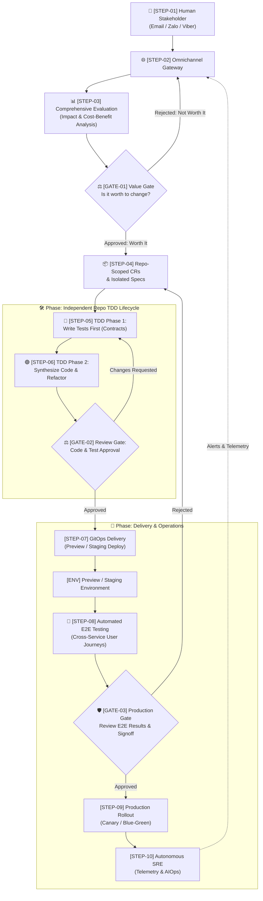

# 🔄 Stratum End-to-End Autonomous Workflow

> This document provides the complete, numbered step-by-step breakdown of how **Stratum** processes an idea or change request. It details the upfront comprehensive change evaluation (unifying impact analysis and cost-benefit feasibility), value gate decision-making, decoupled repository specifications, Test-Driven Development (TDD) lifecycle, automated End-to-End (E2E) testing on staging, gated human approvals, and continuous runtime operations.
> 
> *Note: Data services, event pipelines, and background processing are treated as standard repositories/features contributing to specific business processes and user experiences, governed by this exact same unified lifecycle.*

---

## 🗺️ Visual Architecture Diagram

---

## 📋 Quick Step Index

| Identifier | Step Name | Primary Actor | Key Purpose |
| :--- | :--- | :--- | :--- |
| **`STEP-01`** | **Human Request & Intake** | Human Stakeholder | Submit prompt, bug report, or change idea via Email (`sonnormal@gmail.com`), Zalo, or Viber |
| **`STEP-02`** | **Omnichannel Normalization** | `stratum-gateway` | Authenticate sender, extract intent/attachments, and emit normalized task event |
| **`STEP-03`** | **Comprehensive Change Evaluation** | Strategic Evaluation Agent | Deep **Impact Analysis** (Processes, Features, Repos) + **Cost-Benefit Analysis** (TCO & ROI). Generates [CER Report](templates/change_evaluation_template.md) |
| **`GATE-01`** | **Value & Feasibility Gate** | **Human Reviewer** | **Evaluate ROI and decide: Is this change worth implementing and operating?** |
| **`STEP-04`** | **Repo-Scoped CRs & Isolated Specs** | Orchestrator Engine | Decompose change into standalone specifications and isolated CRs per repository (Domain, Data, Platform) |
| **`STEP-05`** | **TDD Phase 1: Test Specification (Red)** | AI QA Agent | Write 100% automated test suites *first* to define contracts before writing code |
| **`STEP-06`** | **TDD Phase 2: Code Synthesis (Green & Refactor)** | AI Dev Agent | Synthesize minimal code to satisfy tests, followed by automated clean refactoring |
| **`GATE-02`** | **Code & Test Review Gate** | **Human Reviewer** | Review code diffs, unit/integration test logs, coverage, and schema documentation |
| **`STEP-07`** | **Staging & Ephemeral Preview** | GitOps Agent | Apply declarative manifests to spin up preview/staging environment with all microservices |
| **`STEP-08`** | **Automated End-to-End (E2E) Testing** | AI E2E QA Agent | Execute full cross-service automated user journeys, performance checks, and regression suites on live staging |
| **`GATE-03`** | **Production Authorization Gate** | **Human Reviewer** | **Inspect live preview environment + full E2E test execution report to sign off on production release** |
| **`STEP-09`** | **Automated Production Rollout** | GitOps Engine | Execute zero-downtime progressive deployment (Canary / Blue-Green) with automated rollback |
| **`STEP-10`** | **Autonomous SRE Observability** | `stratum-aiops` | Continuously observe metrics, logs, traces, and synthetics; trigger automated RCA alerts |

---

## 🔍 Detailed Step-by-Step Breakdown

### Phase 1: Conversational Intake & Comprehensive Evaluation

#### `STEP-01`: Human Stakeholder Request & Intake
* **Actor:** Human Stakeholder (Owner, Engineer, or Product Lead)
* **Channel:** Email (`sonnormal@gmail.com`), **Zalo**, or **Viber**.
* **Input:** Natural language description of a requested change, feature request, bug fix, or performance enhancement.
* **Process:**
  - Stakeholder sends a prompt, email, or chat message with optional attachments (mockups, log snippets, architecture sketches).
* **Output:** Inbound conversational thread logged in `stratum-gateway`.

---

#### `STEP-02`: Omnichannel Gateway Normalization
* **Actor:** `stratum-gateway` service
* **Input:** Raw webhook payload from Zalo, Viber, or SMTP/IMAP email.
* **Process:**
  1. Authenticates the sender against authorized keys in `.stratum/channels.yaml`.
  2. Extracts intent, thread context, and attachments.
  3. Formats the request into a standard internal CloudEvent.
  4. Returns an instant acknowledgement to the sender via the originating channel.
* **Output:** Normalized `ChangeRequestInitiatedEvent`.

---

#### `STEP-03`: Comprehensive Change Evaluation (Impact & Cost-Benefit Analysis)
* **Actor:** `stratum-orchestrator` (Strategic Evaluation & Architecture Agent)
* **Input:** `ChangeRequestInitiatedEvent`, current architecture documentation, repository topology, and production telemetry baseline.
* **Template Used:** Standardized output conforming to [`docs/templates/change_evaluation_template.md`](templates/change_evaluation_template.md).
* **Unified Evaluation Process:**
  1. **Multi-Level Impact Analysis:**
     - **Process Impact:** Identifies changes to business workflows, operational runbooks, administrative procedures, compliance policies, or CI/CD pipelines.
     - **Feature & Contract Impact:** Analyzes functional contracts, public API changes, backward compatibility, breaking schema updates, and user journey transitions.
     - **Repository Impact:** Maps exact changes to affected repositories (`stratum-services/*`, `stratum-gateway`, `stratum-data-platform`, `stratum-infra`, `stratum-gitops`).
  2. **Implementation Cost Modeling:**
     - Computes estimated agent compute cycles, code complexity, required schema migrations, and potential regression risks based on the repository impact findings.
  3. **Operational Cost Modeling (Ongoing TCO):**
     - Forecasts incremental runtime costs: compute, memory, DB storage, network egress, third-party API licensing, and operational maintenance overhead.
  4. **Business Benefit Assessment & ROI Calculation:**
     - Evaluates expected performance improvements, user experience impact, system resilience, revenue potential, or risk mitigation.
     - Computes net ROI verdict formula: $\text{Net Value} = (\text{Benefits} + \text{Risk Mitigation}) - (\text{Implementation Effort} + \text{3-Year Operational TCO})$.
* **Output:** Comprehensive **Change Evaluation Report (CER)** formatted per [`docs/templates/change_evaluation_template.md`](templates/change_evaluation_template.md).

---

### Phase 2: Upfront Value Gate & Decoupled Repository Decomposition

#### `GATE-01`: Review Gate 1 — Value & Feasibility Gate
* **Actor:** Human Reviewer (via conversational channel)
* **Trigger:** Completion of `STEP-03` CER Report.
* **Notification Delivered:**
  - Sent to **Email** (`sonnormal@gmail.com`), **Zalo**, and **Viber**.
  - Displays: High-level change summary, process/feature/repo impact summary, implementation vs. ongoing operational TCO, and AI strategic recommendation.
* **Decisions:**
  * **Option A: `[Approved: Worth It]`** $\rightarrow$ Advances to **`STEP-04`** (Repo-Scoped Specifications & Isolated CRs).
  * **Option B: `[Rejected: Not Worth It]`** $\rightarrow$ Shelves the change request, records the decision to the audit log, and notifies the requester with justification (preventing wasteful compute and codebase bloat).
  * **Option C: `[Scope Revision]`** $\rightarrow$ Prompts requester to constrain scope or modify acceptance criteria based on high-cost drivers identified in the report.

---

#### `STEP-04`: Repo-Scoped Specifications & Isolated Change Requests
* **Actor:** `stratum-orchestrator`
* **Input:** Approved Change Evaluation Report from `GATE-01`.
* **Process:**
  1. **Decoupled Decomposition:** Decomposes the macro change into independent, repository-specific change requests based on the impact matrix from `STEP-03`.
     - *Applies equally to domain services, data pipelines/streams, and platform integrations.*
  2. **Dedicated Specifications:** Generates a standalone technical specification for each affected repository:
     - Exact API schemas / data contracts (OpenAPI, protobuf, AsyncAPI).
     - Expected behavioral contracts, mock interfaces, and dependency stubs.
  3. **Autonomous Isolation:** Ensures each repository can be developed, tested, and released independently without cross-repo compile-time dependencies or merge blockades.
* **Output:** Set of decoupled, repository-scoped CR tasks dispatched to respective agent worker queues.

---

### Phase 3: Test-Driven Development (TDD) Software Factory

> **Stratum strictly follows Test-Driven Development (TDD):** Automated tests are synthesized and executed *before* implementation code is written across all repositories.

#### `STEP-05`: TDD Phase 1 — Test Specification & Authoring (Red)
* **Actor:** AI QA Agent (Specialized testing model)
* **Input:** Repository-scoped specification from `STEP-04`.
* **Process:**
  1. Creates an isolated feature branch in the target repository (e.g. `agent/cr-104-auth` or `agent/cr-104-datapipeline`).
  2. Synthesizes 100% automated test suites *first*:
     - **Unit Tests:** Boundary checks, input validation, logic assertions, edge cases.
     - **Integration Tests:** Database transactions, cache lookups, and message bus interactions with containerized dependencies (Testcontainers).
     - **Contract Tests:** Strict verification against OpenAPI / AsyncAPI schemas.
  3. Executes test suites in a clean sandbox container:
     - **Verification of "Red":** Confirms that tests fail cleanly for the right reasons before implementation exists.
* **Output:** Committed automated test suite defining the executable specification contract.

---

#### `STEP-06`: TDD Phase 2 — Implementation Code Synthesis & Refactoring (Green & Refactor)
* **Actor:** AI Dev Agent (Specialized coding model)
* **Input:** Failing test suites and technical specification from `STEP-05`.
* **Process:**
  1. **Make Tests Pass (Green):** Synthesizes the minimal, high-quality application code required to satisfy all failing tests.
  2. **Execution & Validation:** Re-runs test automation in the sandbox until 100% of test assertions pass.
  3. **Refactor:** Optimizes algorithms, eliminates redundancy, ensures idiomatic conventions, and updates documentation/type annotations without breaking tests.
  4. Generates a pull request with full test execution reports and diff summaries.
* **Output:** Clean code pull request with 100% green test suite in the target repository.

---

### Phase 4: Staging, Automated E2E Testing & Pre-Production Gate

#### `GATE-02`: Review Gate 2 — Code, Test & Architecture Approval
* **Actor:** Human Reviewer (via conversational channel)
* **Trigger:** 100% unit and integration test pass rate and clean lint/security audit in `STEP-06`.
* **Notification Delivered:**
  - Sent to **Email** (`sonnormal@gmail.com`), **Zalo**, and **Viber**.
  - Includes: Change summary, code diff link, test execution matrix, code coverage metrics, and interactive action buttons.
* **Decisions:**
  * **Option A: `[Approve]`** $\rightarrow$ Advances to **`STEP-07`** (Staging & Ephemeral Preview Deployment).
  * **Option B: `[Changes Requested]`** $\rightarrow$ Re-routes back to **`STEP-05`** (QA/Dev agents) with human guidance notes for autonomous revision.
  * **Option C: `[Reject]`** $\rightarrow$ Closes branch and records termination to audit log.

---

#### `STEP-07`: GitOps Staging & Ephemeral Preview Deployment
* **Actor:** GitOps Delivery Agent (`stratum-gitops`)
* **Input:** Approved pull request from `GATE-02`.
* **Process:**
  1. Builds and tags container images for all updated repositories.
  2. Updates declarative Kubernetes manifests / Helm charts in `stratum-gitops`.
  3. Provisions an isolated ephemeral preview environment (or updates the shared staging cluster) with all microservices interconnected.
  4. Runs health checks to verify that all pods, databases, and message brokers are healthy and ready to receive traffic.
* **Output:** Live, running staging preview environment ready for comprehensive end-to-end testing.

---

#### `STEP-08`: Automated End-to-End (E2E) System Testing
* **Actor:** AI E2E QA Agent (`stratum-orchestrator:e2e-runner`)
* **Input:** Live ephemeral preview environment deployed in `STEP-07`.
* **Process:**
  1. **Full User Journey Execution:**
     - Simulates complete end-to-end flows across all services (e.g. Inbound message $\rightarrow$ Gateway $\rightarrow$ Orchestrator $\rightarrow$ Domain Microservice $\rightarrow$ Database persistence $\rightarrow$ Data platform ingestion/sync $\rightarrow$ Outbound response).
  2. **Cross-Service Contract & Security Validation:**
     - Tests live network communication, JWT token handoffs, CORS, rate limits, and TLS certificates across services.
  3. **Synthetic Load & Latency Assertion:**
     - Sends concurrent synthetic traffic to verify p95/p99 response latencies match SLO requirements.
  4. **Regression Verification:**
     - Executes the broader automated regression suite to ensure adjacent unaffected features continue functioning flawlessly.
* **Output:** **Automated E2E Test Execution & Verification Report** (100% pass status, execution traces, response times, and failure diagnostics if any).

---

#### `GATE-03`: Review Gate 3 — Production Gate Approval (E2E Sign-Off)
* **Actor:** Human Reviewer (via conversational channel)
* **Trigger:** Completion of `STEP-08` with 100% passing E2E test suite.
* **Notification Delivered:**
  - Sent to **Email** (`sonnormal@gmail.com`), **Zalo**, and **Viber**.
  - Displays:
    - **Staging Preview URL** (for manual walkthrough or visual inspection if desired).
    - **E2E Test Execution Summary:** Number of journeys executed, 100% pass rate badge, latency metrics.
    - **Trace Links & Logs:** Clickable deep-links to OpenTelemetry traces from the E2E run.
    - **Automated Rollback Plan:** Pre-configured canary rollback thresholds.
* **Decisions:**
  * **Option A: `[Approve Production]`** $\rightarrow$ Signs off on release; advances to **`STEP-09`** (Automated Production Rollout).
  * **Option B: `[Reject / Abort]`** $\rightarrow$ Tears down preview environment, notifies requester, and re-routes back to `STEP-04` with feedback notes.

---

### Phase 5: Production Delivery, SRE & Closed-Loop Operations

#### `STEP-09`: Automated Production Rollout
* **Actor:** GitOps Delivery Engine (ArgoCD / Flux)
* **Input:** Cryptographically signed production approval token from `GATE-03`.
* **Process:**
  1. Merges feature PR into `main`.
  2. Executes progressive delivery strategy (Canary or Blue-Green rollout).
  3. Shifts live traffic incrementally (10% $\rightarrow$ 25% $\rightarrow$ 50% $\rightarrow$ 100%) while continuously querying telemetry error rates and response latencies.
  4. Automatically triggers an immediate rollback if latency or error thresholds breach SLO limits.
* **Output:** Successfully released production version with zero downtime.

---

#### `STEP-10`: Autonomous SRE Observability & Telemetry
* **Actor:** `stratum-aiops` (Autonomous SRE Agent)
* **Input:** Continuous telemetry stream (OpenTelemetry traces, Prometheus metrics, structured logs, synthetic health probes).
* **Process:**
  1. Tracks golden signals: Latency, Traffic, Errors, and Saturation.
  2. Runs ML-driven anomaly detection to identify performance regressions or failure patterns.
  3. When an anomaly is detected:
     - Automatically isolates logs and traces to conduct Root Cause Analysis (RCA).
     - Synthesizes a diagnostic report and recommended remediation patch.
     - Dispatches real-time alerts back through `STEP-02` (Gateway) to **Email**, **Zalo**, and **Viber**.
* **Output:** Real-time health metrics, automated RCAs, and incident alerts.
