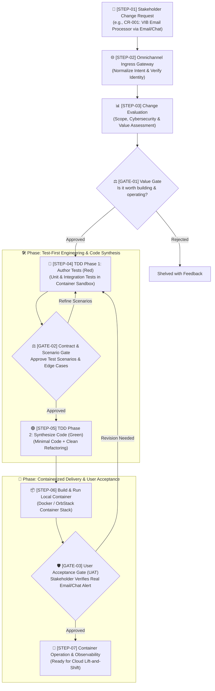

# 🔄 Stratum Lean Autonomous Workflow

> **Core Philosophy:** 100% AI-generated code, strict Test-Driven Development (TDD), and containerized portability—governed by three strategic Human-in-the-Loop review gates via **Email (`sonnormal@gmail.com`)**, **Zalo**, and **Viber**.
>
> *Note on Scope:* In this phase, testing focuses strictly on **Tier 1 (Unit Tests)** and **Tier 2 (Integration Tests with containerized databases)**. Cross-service End-to-End (E2E) journey automation is intentionally deferred. Every new feature—including the initial platform implementation—is treated and executed as a formal **Change Request (CR)**.

---

## 🗺️ Visual Lifecycle Diagram

---

## 🏛️ The Three Human Governance Gates

Human oversight is concentrated at three high-leverage decision points:

| Gate | Name | Core Question | What the Human Inspects |
| :--- | :--- | :--- | :--- |
| **`GATE-01`** | **Value & Feasibility Gate** | *"Why do it & is it worth it?"* | Scope, cybersecurity (credentials/OAuth access), and cost-benefit feasibility before any code is written. |
| **`GATE-02`** | **Contract & Test Scenario Gate** | *"What exact behavior to build?"* | Plain-language test scenarios and edge cases (e.g. VIB email formats, malformed data, debit vs. credit) *before* code synthesis. |
| **`GATE-03`** | **User Acceptance Gate (UAT)** | *"Does it work in reality?"* | Live container execution with sample/real VIB email, verifying database storage and Zalo/Viber chat alert. |

---

## 📋 Step-by-Step Lifecycle (Walked through `CR-001`)

To make the workflow concrete, here is how the initial implementation (**`CR-001: VIB Transaction Alert & Digest`**) executes through the 7 steps:

---

### Phase 1: Request Intake & Value Gate

#### `STEP-01`: Change Request Intake
* **Actor:** Human Stakeholder (via Email, Zalo, or Viber)
* **Example Intake Prompt:**  
  > *"CR-001: Read my mailbox `sonnormal@gmail.com`, filter emails from `vib.com.vn`, parse transaction details, store them in a database, and send me an instant alert on Zalo/Viber."*
* **Output:** Normalized task event dispatched to `stratum-orchestrator`.

#### `STEP-02`: Gateway Normalization
* **Actor:** `stratum-gateway`
* **Process:** Authenticates sender against allowed list (`sonnormal@gmail.com`, verified chat ID) and assigns tracking ID `CR-001`.

#### `STEP-03`: Change Evaluation & Cybersecurity Assessment
* **Actor:** Evaluation Agent
* **Analysis Performed:**
  1. **Functional Scope:** Ingress (IMAP/Gmail API), Parser service, Database storage, Egress (Zalo/Viber bot).
  2. **Cybersecurity & Secrets:**
     - How are Gmail credentials stored? (Never hardcoded; use App Passwords or OAuth2 refresh tokens in container environment variables / secrets).
     - Financial data privacy (mask card numbers in logs and notifications).
  3. **Implementation Effort:** Minimal, containerized Node.js/Python service + PostgreSQL container.
* **Output:** Formatted Change Evaluation Report ([CER Template](templates/change_evaluation_template.md)).

#### `GATE-01`: Review Gate 1 — Value & Feasibility Gate
* **Delivered to:** **Email**, **Zalo**, and **Viber**.
* **Human Action:** Stakeholder reviews scope, security posture, and verifies the change is worth building $\rightarrow$ **`[Approved: Worth It]`**.

---

### Phase 2: Test-First Engineering & Code Synthesis

> **Testing Rule:** Only **Tier 1 (Unit)** and **Tier 2 (Integration)** tests are written. Sibling services or live external mailboxes are mocked using stubs and ephemeral database containers (**Testcontainers**).

#### `STEP-04`: TDD Phase 1 — Test Specification & Scenario Authoring (Red)
* **Actor:** AI QA Agent
* **Process:** Synthesizes automated tests *before* writing application code:
  * **Unit Tests (Tier 1):**
    - Parsing regex for VIB email subject lines (`Biến động số dư`, `Giao dịch thẻ`).
    - Extracting amounts (handling commas, dots, `VND` suffix), dates, and masked account strings.
    - Handling promotional or non-transaction emails from `vib.com.vn` (safely ignore without error).
  * **Integration Tests (Tier 2):**
    - Spinning up a temporary PostgreSQL container via Docker/Testcontainers.
    - Testing database migrations, table schema constraints, and duplicate transaction idempotency (ensuring the same email isn't recorded twice).
* **Output:** Failing test suite (`Red`) + Human-readable test scenario list.

#### `GATE-02`: Review Gate 2 — Contract & Test Scenario Gate
* **Delivered to:** **Email**, **Zalo**, and **Viber**.
* **Human Action:** Stakeholder inspects the test scenario checklist:
  * *"Does this cover all VIB transaction types (credit card, debit, e-banking transfer)?"*
  * *"Does it handle international transaction currencies (USD, EUR)?"*
* **Decision:** Stakeholder approves scenarios or replies with missing edge cases.

#### `STEP-05`: TDD Phase 2 — Autonomous Code Synthesis & Refactoring (Green)
* **Actor:** AI Dev Agent
* **Process:**
  1. Writes the minimal implementation code to make all approved Unit & Integration tests pass (`Green`).
  2. Refactors for clean code architecture, error handling, and structured logging.
  3. Validates that 100% of tests pass cleanly in the local container sandbox.
* **Output:** Clean code PR with 100% green test suite.

---

### Phase 3: Containerized Delivery & User Acceptance

#### `STEP-06`: Container Build & Local UAT Deployment
* **Actor:** Delivery Agent
* **Process:**
  1. Builds standard container image via `Dockerfile`.
  2. Starts the container stack via `docker compose up -d` in **OrbStack / Docker**:
     - `vib-service`: Application runner.
     - `postgres`: Persistent local database.
  3. Verifies container health check (`/healthz` returns `200 OK`).
* **Output:** Operational local container stack ready for verification.

#### `GATE-03`: Review Gate 3 — User Acceptance Gate (UAT Sign-off)
* **Delivered to:** **Email**, **Zalo**, and **Viber**.
* **Human Action:**
  - Stakeholder triggers a sample VIB email or feeds a raw test `.eml` into the container.
  - Stakeholder checks:
    - Did the transaction row appear in PostgreSQL?
    - Did the Zalo / Viber test bot send a clean notification message?
* **Decision:** Stakeholder replies **`[Accept & Sign Off]`** to approve the release.

#### `STEP-07`: Continuous Container Operation & Cloud Readiness
* **Actor:** Local Container Daemon / Future Cloud Runner
* **Process:**
  - Container runs stably in the background on OrbStack.
  - Architecture is 100% standard Docker—ready to be deployed to any cloud provider (AWS ECS, Fly.io, or K8s) whenever public 24/7 internet access is desired.

---

## 🎯 Summary Takeaways

1. **Pragmatic Scope:** No complex E2E test suites or cloud CI bills needed early on. Unit tests + Integration tests with containerized PostgreSQL give 90% bug protection.
2. **Every Change is Governed:** Whether building the initial skeleton (`CR-001`) or adding a new feature later, everything goes through the 3 Human Gates.
3. **Container Portability:** Built on Docker from day one—zero lock-in, effortless migration to the cloud.
