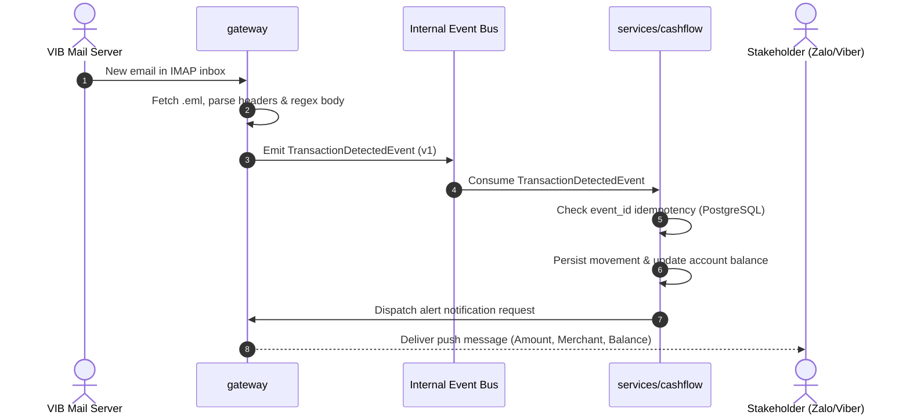

# FLOW-001: Inbound Email Transaction Ingestion & Alerting

> **Flow ID:** `FLOW-001`  
> **Status:** `ACTIVE`  
> **Trigger:** Polling bank transaction alert emails via IMAP/OAuth  
> **Participating Repositories:** [`gateway`](file:///Users/son/Projects/Stratum/gateway), [`services/cashflow`](file:///Users/son/Projects/Stratum/services/cashflow)  
> **Relevant Contracts:** [`contracts/events/transaction_detected.v1.json`](../contracts/events/transaction_detected.v1.json)  
> **Related Features:** [`features/vib-transaction-alert.md`](../features/vib-transaction-alert.md)

---

## 📌 1. Overview & Objective

This flow automates the ingestion of financial alert emails sent by banks (starting with VIB). When an alert arrives, `gateway` parses the raw MIME email, normalizes the financial data, and emits a standard `TransactionDetectedEvent`. The domain service `services/cashflow` consumes the event, enforces idempotency, updates account movements and balances in PostgreSQL, and routes an instant alert notification to the stakeholder via Zalo/Viber through `gateway`.

---

## 🗺️ 2. Cross-Repo Sequence Diagram (Workflow)

---

## 🔄 3. Step-by-Step Execution & Data Transformation (Dataflow)

### Step 1: Raw Ingress & Parsing (`gateway`)
* **Input:** Raw RFC 5322 `.eml` payload from bank mail servers (e.g. `vib.com.vn`).
* **Transform:** Regex extractor parses amount, currency, account mask, transaction type, and date.
* **Contract Output:** Canonical [`TransactionDetectedEvent` (v1)](../contracts/events/transaction_detected.v1.json).

### Step 2: Persistence & Idempotency (`services/cashflow`)
* **Input:** `TransactionDetectedEvent` (v1).
* **Processing:** 
  1. Checks if `event_id` or `raw_source_ref` already exists in PostgreSQL unique index.
  2. Commits account movement and updates current account balance.
  3. Formats conversational alert payload for notification delivery.
* **Output:** Push notification request routed to `gateway` for dispatch.

---

## 🛡️ 4. Failure Modes & Resilience

| Scenario | Handled By | Behavior |
| :--- | :--- | :--- |
| **Email is not a transaction alert** | `gateway` | Safely ignored; logs info without emitting event. |
| **Duplicate email retrieved from IMAP** | `services/cashflow` | Dropped gracefully via unique constraint on `raw_source_ref`. |
| **PostgreSQL container unreachable** | `services/cashflow` | Event stays on queue / retry buffer with exponential backoff. |
