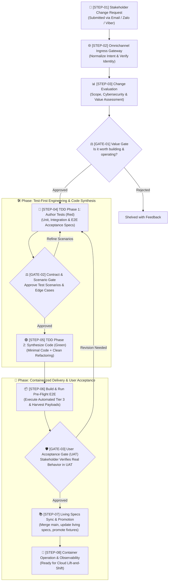

# 🔄 Stratum Universal Autonomous Development Lifecycle (SDLC)

> **Core Philosophy:** 100% AI-generated code, strict Test-Driven Development (TDD), and containerized portability—governed by three strategic Human-in-the-Loop review gates via **Email**, **Zalo**, and **Viber**.
>
> *Scope & Applicability:* This lifecycle governs **every change**—from initial platform setup (e.g., `CR-26j001`) to new microservices, features, refactoring, and bug fixes. Verification follows a 3-tier automated model: **Tier 1 (Unit)**, **Tier 2 (Integration via Testcontainers)**, and **Tier 3 (Automated Multi-Service E2E)**, governed by three strategic Human-in-the-Loop review gates.

---

## 🗺️ Visual Lifecycle Diagram



---

## 🏛️ The Three Human Governance Gates

Human oversight is concentrated at three strategic, high-leverage decision points:

| Gate | Name | Core Question | What the Human Inspects |
| :--- | :--- | :--- | :--- |
| **`GATE-01`** | **Value & Feasibility Gate** | *"Why do it & is it worth it?"* | Scope, cybersecurity (credentials, secrets, access control), and cost-benefit feasibility before any code is written. |
| **`GATE-02`** | **Contract & Test Scenario Gate** | *"What exact behavior to build?"* | Plain-language test scenarios, edge cases, AND the complete Acceptance / UAT Test Suite (happy, edge, and unhappy paths) *before* implementation code is synthesized. |
| **`GATE-03`** | **User Acceptance Gate (UAT)** | *"Does it work in reality?"* | Automated execution scorecard of pre-approved Tier 3 E2E suite, and live verification of physical stakeholder outcomes (e.g. mobile chat alerts, web UI). |

---

## 📋 Universal Step-by-Step Breakdown

---

### Phase 1: Request Intake & Value Gate

#### `STEP-01`: Change Request Intake
* **Actor:** Human Stakeholder (via Email, Zalo, or Viber)
* **Input:** Natural language prompt describing a change, new service, bug fix, or integration.
* **Output:** Inbound raw message received by `gateway`.

#### `STEP-02`: Gateway Normalization & Identity Verification
* **Actor:** `gateway`
* **Process:** 
  1. Authenticates sender against allowed list (verified email, verified chat ID).
  2. Extracts intent, parameters, and attachments.
  3. Assigns a formal tracking ID conforming to the `CR-YYaXXX` convention (e.g. `CR-26j001`).
  4. Initializes the master change record `request.md` in `meta/changes/CR-YYaXXX-<short-title>/`.
* **Output:** Normalized `ChangeRequestInitiatedEvent` and initialized `request.md`.

#### `STEP-03`: Comprehensive Change Evaluation & Cybersecurity Assessment
* **Actor:** Strategic Evaluation Agent
* **Analysis Performed:**
  1. **Impact Analysis:** Affected repositories (`services/*`, `gateway`, `web`, `meta`), data schemas, and API contracts.
  2. **Cybersecurity & Secrets Assessment:** Authentication mechanisms, credentials/tokens management (zero hardcoded secrets), data sensitivity/masking, and attack surface.
  3. **Cost-Benefit Modeling:** Implementation compute effort vs. operational benefits.
* **Output:** Formatted Change Evaluation Report (saved to `meta/changes/CR-YYaXXX-<short-title>/evaluation.md` per [CER Template](../templates/evaluation.md)).

#### `GATE-01`: Review Gate 1 — Value & Feasibility Gate
* **Delivered to:** **Email**, **Zalo**, and **Viber**.
* **Human Action:** Stakeholder reviews scope, security posture, and business value.
* **Audit Trail:** Decision recorded in `request.md`.
* **Decisions:**
  * `[Approved: Worth It]` → Proceeds to `STEP-04`.
  * `[Rejected: Not Worth It]` → Shelves the change with justification.
  * `[Scope Revision]` → Prompts requester to constrain scope.

---

### Phase 2: Test-First Engineering & Code Synthesis

> **Testing Policy:** AI Agents autonomously execute 3 automated testing tiers: **Tier 1 (Unit)**, **Tier 2 (Integration via Testcontainers)**, and **Tier 3 (Automated Multi-Service E2E)**. Microservice repositories contain Tier 1 and Tier 2 tests; multi-service Tier 3 E2E test scripts and orchestration reside in `stratum-meta/tests/e2e/` and `stratum-meta/scripts/`.
>
> **Repository Scoping:** Unit and integration tests involve only one repository. Consequently, repo-specific test specifications (`scenario.md`) and initial test fixtures (`fixtures/`) are authored and stored directly in the specific target repository being modified.

#### `STEP-04`: TDD Phase 1 — Test Specification & Scenario Authoring (Red)
* **Actor:** AI QA Agent
* **Process:** Synthesizes automated tests and acceptance suites *before* writing application code:
  * **Unit Tests (Tier 1):** Domain business logic, mathematical/state transitions, parsing regex, boundary values, and edge cases in memory.
  * **Integration Tests (Tier 2):** Database persistence, schema migrations, unique constraints, transactional rollbacks, and event bus emissions in ephemeral Testcontainers. Parametrically bound to existing fixtures in `<repo>/tests/fixtures/real/`.
  * **Acceptance / UAT Test Suite Specification:** Authors the complete acceptance suite in `<target-repo>/changes/CR-YYaXXX/scenario.md` covering Happy Paths, Edge Cases (e.g. empty inputs), and Unhappy/Failure Paths (e.g. third-party network outages, timeouts).
  * **Automated E2E Test Code (Tier 3):** Translates approved acceptance cases 1-to-1 into automated E2E test harnesses in `stratum-meta/tests/e2e/` and orchestration scripts (`stratum-meta/scripts/uat-verify.sh`).
  * **Fixture Cold-Start:** Generates initial synthetic test fixtures in `<target-repo>/changes/CR-YYaXXX/fixtures/`.
  * Confirms all new tests fail cleanly in sandbox (`Red` state).
* **Output:** Committed test suites + repo-specific `scenario.md`, initial `fixtures/`, and automated Tier 3 E2E scripts for human review.

#### `GATE-02`: Review Gate 2 — Contract & Test Scenario Gate
* **Delivered to:** **Email**, **Zalo**, and **Viber**.
* **Human Action:** Stakeholder reviews:
  1. Plain-language technical specifications and schema invariants.
  2. Tier 1 & Tier 2 automated test specifications.
  3. **Complete Acceptance / UAT Test Suite:** Happy paths, edge cases, and critical failure/unhappy modes.
* **Audit Trail:** Decision recorded in `request.md`.
* **Decisions:**
  * `[Approve Scenarios]` → Advances to `STEP-05`. AI Dev Agent now has explicit requirements for resilient error handling, retries, and structured logging.
  * `[Add / Refine Scenarios]` → Stakeholder adds missing real-world edge cases; QA Agent updates test suite.
  * `[Reject]` → Closes branch and terminates CR.

#### `STEP-05`: TDD Phase 2 — Autonomous Code Synthesis & Refactoring (Green & Refactor)
* **Actor:** AI Dev Agent
* **Process:**
  1. Synthesizes minimal code required to satisfy all approved tests, including graceful handling of all approved unhappy paths (`Green`).
  2. Refactors algorithms, cleans architecture, and ensures structured logging without breaking tests.
  3. Validates that 100% of test assertions pass in the local sandbox.
* **Output:** Clean code PR with 100% green test suite.

---

### Phase 3: Containerized Delivery & User Acceptance

#### `STEP-06`: Container Build, Pre-Flight Tier 3 E2E Execution & Payload Harvesting
* **Actor:** Delivery Agent
* **Process:**
  1. Builds standardized container image via `Dockerfile`.
  2. Launches container stack via `docker compose up -d` in **OrbStack / Docker**.
  3. Verifies container health checks (`/healthz` returns `200 OK`).
  4. **Executes Automated Pre-Flight Tier 3 E2E Suite:** Runs pre-approved test cases (`TC-01`..`TC-06`) against live containers and external boundaries.
  5. **Harvests Raw Inbound Payloads:** Inbound payloads (e.g. live emails, webhooks) are captured byte-for-byte to `scratch/harvested/raw_<source>_<timestamp>.<ext>`.
  6. **Generates Timestamped UAT Scorecard:** Outputs execution report to `meta/changes/CR-YYaXXX/uat_results_YYYYMMDD_HHMMSS.md`.
* **Output:** Operational container stack, captured payload logs, and timestamped UAT scorecard ready for human sign-off.

#### `GATE-03`: Review Gate 3 — User Acceptance Gate (UAT Sign-off)
* **Delivered to:** **Email**, **Zalo**, and **Viber**.
* **Human Action:** 
  1. Stakeholder reviews the automated Tier 3 E2E execution scorecard generated in `STEP-06`.
  2. Stakeholder performs **selective physical smoke verifications** that cannot be automated (e.g. verifying physical alert buzz on mobile phone screen, subjective UI aesthetics).
* **Audit Trail:** Sign-off recorded in `request.md`.
* **Decisions:**
  * `[Accept & Sign Off]` → Feature accepted; advances to `STEP-07`.
  * `[Request Changes]` → Feedback notes provided; re-routes to `STEP-04`.
  * `[Reject / Abort]` → Reverts deployment.

#### `STEP-07`: Living Specifications Synchronization, Fixture Promotion & Main Promotion
* **Actor:** AI Documentation & Platform Agent
* **Trigger:** Stakeholder approves `GATE-03` (`[Accept & Sign Off]`).
* **Process:**
  1. **Git Main Promotion:** Merges feature branches (`cr-YYaXXX-...`) into `main` across all affected repositories (`services/*`, `gateway`, `meta`).
  2. **Living Cumulative Specifications Update (The Delta Merge):**
     * **Living Features (`features/<feature>.md`):** Merges new user journeys, acceptance criteria, and edge cases from the CR into cumulative living feature specs.
     * **Living Flows (`flows/<flow>.md`):** Merges updated sequence choreographies, event payloads, and communication paths.
     * **Living Architecture (`architecture/topology/<topology>.md`):** Merges newly operational containers, networks, ports, and storage volumes into the cumulative topology spec.
     * **Living Contracts (`contracts/`):** Seals and promotes backward-compatible schema updates.
  3. **UAT-to-Integration Fixture Feedback Loop (Permanent Promotion):**
     * Sanitizes raw payloads captured in `STEP-06` (redacts account numbers, tokens, emails, while preserving exact MIME/HTML structure and encodings verbatim).
     * Promotes sanitized files to `<repo>/tests/fixtures/real/<bank>_<version>_<descriptor>.<ext>`.
     * **Permanent Retention Rule:** Every unique format or template variation is retained indefinitely. Never overwrite historical fixtures.
     * Binds Tier 2 integration tests parametrically (`@pytest.mark.parametrize`) to enforce monotonic regression defense across all historical formats.
  4. **Lean Tier 3 E2E Regression Promotion:**
     * Merges canonical user journey into `stratum-meta/tests/e2e/regression/`.
     * Defers format variations and timeout edge cases to Tier 2 integration tests.
  5. **Change Request Archival:** Marks the Change Request folder (`meta/changes/CR-YYaXXX/`) as `PROMOTED`, preserving it as an immutable historical delta record.
* **Output:** Clean `main` branches, updated living documentation, permanently hardened regression suites, and archived CR audit trail.

#### `STEP-08`: Continuous Container Operation & Cloud Readiness
* **Actor:** Local Container Daemon / Future Cloud Runner
* **Process:**
  - Container runs stably in the background on OrbStack.
  - Architecture is 100% standard Docker/OCI—ready to be deployed to Kubernetes whenever 24/7 public access is needed.

---

## 🗃️ Change Tracking in `changes/`

All changes are archived in the `changes/` directory of `meta`. Every change is organized using the **One Folder per Change** model with the **`CR-YYaXXX`** identification standard:

### 1. Change ID Convention (`CR-YYaXXX`)
* **`YY`**: 2-digit Year (e.g. `26` for 2026).
* **`a`**: Single **lowercase letter** denoting the month:
  * `a` = January, `b` = February, `c` = March, `d` = April, `e` = May, `f` = June
  * `g` = July, `h` = August, `i` = September, **`j` = October**, `k` = November, **`m` = December** *(skips `l` to prevent confusion with `1`)*
* **`XXX`**: 3-digit sequence in that month (`001`, `002`, `003`...).
* *Example:* **`CR-26j001`** is the 1st change request in October 2026.

### 2. Folder Structure per Change

Stratum enforces a strict separation of concerns between **central change governance & documentation** (in `meta`) and **repo-scoped executable test contracts & fixtures** (in specific repositories).

#### A. Central Change Record (`meta/changes/CR-YYaXXX-<short-title>/`)
```text
changes/CR-YYaXXX-<short-title>/
├── request.md        # Master request intake, overview, status, and gate approval audit log (Gate 1, 2, 3)
├── evaluation.md     # STEP-03 / GATE-01 Report (Scope, Security, Cost-Benefit)
└── docs/             # Supporting documentation (domain research, RFCs, API contracts, schemas) (optional)
```

* **`request.md`**: Master audit document capturing the original stakeholder prompt, intake channel, requester metadata, lifecycle status, and decision audit logs for `GATE-01`, `GATE-02`, and `GATE-03`.
* **`evaluation.md`**: Change Evaluation Report (CER) detailing impact analysis, STRIDE threat model, and cost-benefit feasibility.
* **`docs/` (Supporting Docs)**: Each change may have supporting docs (e.g. domain research, architecture spikes, user flow diagrams, or reference specifications).

#### B. Repo-Specific Test Scenarios & Fixtures (`<target-repo>/changes/CR-YYaXXX-<short-title>/`)
Because Tier 1 (Unit) and Tier 2 (Integration) tests verify an isolated single repository without cross-repo coupling, the test scenarios and fixture data are stored within the specific target repository:

```text
<target-repo>/changes/CR-YYaXXX-<short-title>/
├── scenario.md       # STEP-04 / GATE-02 Approved plain-language test scenarios for this repo
└── fixtures/         # Sample test data, raw emails (.eml), mock payloads for Unit & Integration tests
```

* **`scenario.md`**: Plain-language test scenarios and edge cases authored specifically for this repository's unit and integration tests.
* **`fixtures/`**: Repository-specific test fixtures, sample inputs (e.g., sample raw `.eml` emails, mock HTTP responses, seed database rows).
