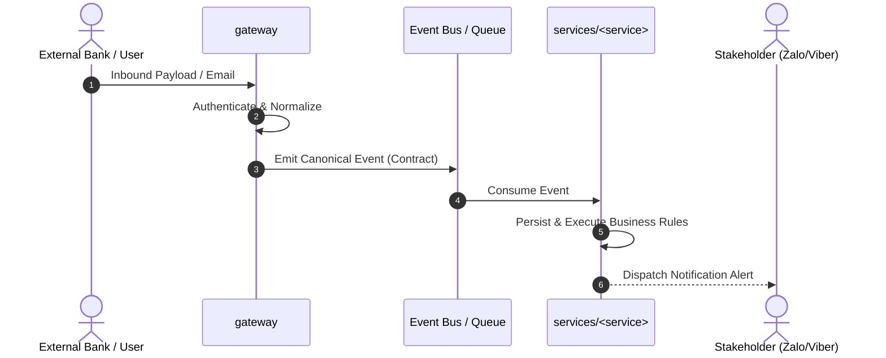

# FLOW-XXX: [Descriptive Flow Title]

> **Flow ID:** `FLOW-XXX`  
> **Status:** `ACTIVE` / `IN_DESIGN` / `DEPRECATED`  
> **Trigger:** Inbound Webhook / Scheduled Cron / User Command / IMAP Poll  
> **Participating Repositories:** `gateway`, `services/<service>`  
> **Relevant Contracts:** [`contracts/events/...`](../contracts/)

---

## 📌 1. Overview & Objective

*Brief 1-2 paragraph description of the end-to-end journey. What business outcome does this flow fulfill?*

---

## 🗺️ 2. Cross-Repo Sequence Diagram (Workflow)

---

## 🔄 3. Step-by-Step Execution & Data Transformation (Dataflow)

### Step 1: Ingress & Normalization
* **Responsible Repo:** `gateway`
* **Input Shape:** Raw external protocol (e.g. RFC 5322 MIME email, webhook payload).
* **Processing:** Validates signatures, strips headers, extracts domain entity.
* **Output / Handoff:** Publishes canonical event conforming to [`contracts/events/...`](../contracts/).

### Step 2: Domain Processing & Persistence
* **Responsible Repo:** `services/<service>`
* **Input Shape:** Validated canonical event.
* **Processing:** Idempotency check, state updates, business calculation, database transaction.
* **Side Effects:** Stores record in PostgreSQL; dispatches notifications.

---

## 🛡️ 4. Failure Modes & Resilience

| Failure Scenario | Where Detected | Recovery / Retry Strategy |
| :--- | :--- | :--- |
| **Malformed Inbound Payload** | `gateway` | Log warning, send to Dead Letter Queue (DLQ), zero retries. |
| **Database Connection Timeout** | `services/*` | Exponential backoff retry (up to 3 attempts), transaction rollback. |
| **Duplicate Event Delivery** | `services/*` | Idempotent deduplication via unique `event_id`. |
